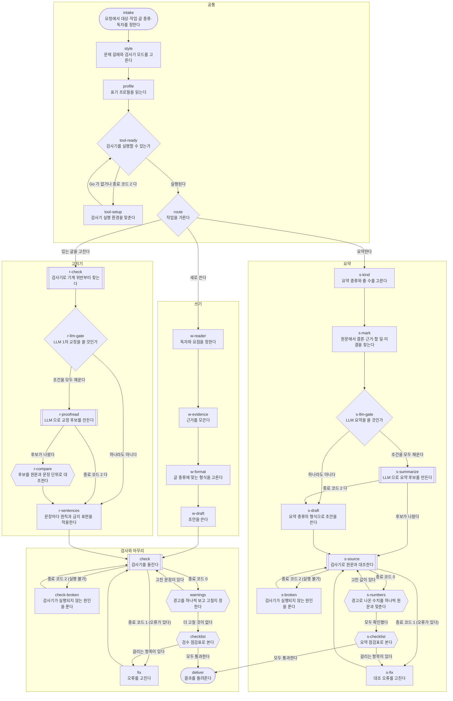
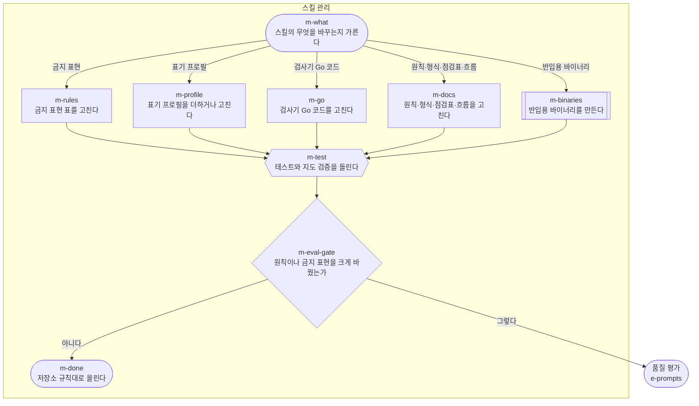
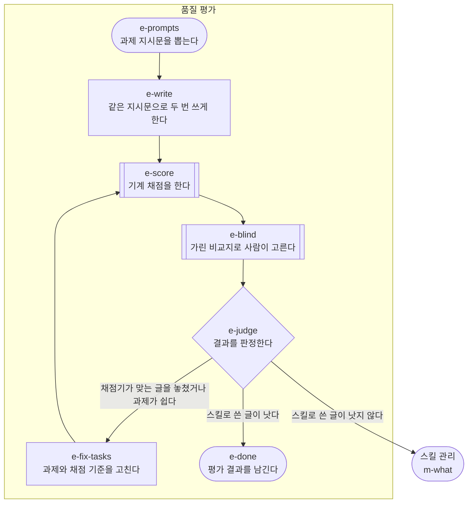

# yd-writer-kr 흐름 지도

<!-- flow_map.py --write 가 flow.yaml 에서 만든 파일이다. 손으로 고치지 않는다. -->

요청을 받아 결과를 돌려줄 때까지 거치는 단계를 모두 적었다. 원본은 `flow.yaml` 이다.
단계를 건너뛰지 않으려면 시작 단계부터 화살표를 따라간다. 갈림에서는 조건에 맞는 화살표 하나만 고른다.

| 모양 | 뜻 |
|---|---|
| 둥근 상자 | 시작과 끝 |
| 네모 | 사람이나 에이전트가 하는 단계 |
| 마름모 | 갈림. 조건을 보고 한쪽으로 간다 |
| 겹네모 | 스크립트를 돌리는 단계 |
| 육각형 | 관문. 통과 조건을 채워야 다음으로 간다 |

흐름은 3개, 단계는 47개다.

## 글 작업

시작 단계는 `intake` 다.



### 공통

| 단계 | 할 일 | 문서 절 | 쓰는 것 | 다음 |
|---|---|---|---|---|
| `intake`<br>요청에서 대상·작업·글 종류·독자를 정한다<br>(시작) | 대상은 파일 경로나 본문이다. 작업은 새로 쓰기, 고치기, 요약하기 가운데 하나다.<br>글 종류(이슈, 공지, README 등)와 독자를 정한다.<br>빠진 값은 대상과 주변 문서로 추정하고, 추정한 값을 보고에 적는다.<br>독자나 요점을 추정할 수 없으면 묻는다.<br>사용자가 다른 문체를 지시하면 그 지시를 따른다. | 예외 |  | `style` |
| `style`<br>문체 갈래와 검사기 모드를 고른다<br>(단계) | 이슈·MR·커밋 본문·docs·보고서는 표준 문어체다. 검사기는 기본 모드다.<br>README·안내·공지·블로그는 합니다체도 된다. 명사형 종결 금지는 같다.<br>채팅 답장은 대화체다. 원칙 1·3·5 만 쓰고 검사기는 --chat 이다.<br>소설·에세이는 작가의 문체를 따른다. 검사기는 --prose 다.<br>코드·명령어·식별자·표 안의 값·인용문·고유명사는 건드리지 않는다.<br>한 문서 안에서 문체를 섞지 않는다. 기존 문서는 그 문서의 문체를 따른다. | 0. 어디에 쓰나 — 문체 두 갈래 |  | `profile` |
| `profile`<br>표기 프로필을 읽는다<br>(단계) | 프로필 파일의 표기 규칙 절을 읽는다. 기본은 doksam 이다.<br>다른 조직의 글이면 그 조직 프로필을 읽고 검사기에 --profile 을 준다.<br>코드·명령·경로·식별자는 백틱으로 감싼다.<br>시크릿 값은 어떤 글에도 쓰지 않는다. | 표기 규칙 — 프로필 | `references/profiles/doksam.md`<br>`references/profiles/README.md` | `tool-ready` |
| `tool-ready`<br>검사기를 실행할 수 있는가<br>(갈림) | bash 와 Go 1.22 이상이 있으면 래퍼가 처음 실행할 때 빌드한다.<br>빌드한 바이너리가 있으면 CHECK_WRITING_BIN 으로 지정한다. |  | `scripts/check-writing` | `route` — 실행된다<br>`tool-setup` — Go 가 없거나 종료 코드 2 다 |
| `tool-setup`<br>검사기 실행 환경을 맞춘다<br>(단계) | 릴리스의 바이너리를 받아 SHA256SUMS 와 대조한 뒤 반입한다.<br>bash 가 있으면 CHECK_WRITING_BIN 만 지정하고 래퍼를 그대로 쓴다.<br>bash 가 없으면 실행 파일을 바로 부르고 규칙 파일을 CHECK_WRITING_RULES 나 --rules 로 알려 준다.<br>글은 UTF-8 로 저장한다. CP949 로 저장한 글은 종료 코드 2 다.<br>윈도우 콘솔은 chcp 65001 이나 OutputEncoding 으로 한글 출력을 맞춘다.<br>릴리스에 없는 플랫폼은 build-binaries 로 교차 빌드한다. | 폐쇄망·윈도우 — 빌드한 바이너리 쓰기 | `scripts/check_writing.py`<br>`scripts/build-binaries.sh` | `tool-ready` |
| `route`<br>작업을 가른다<br>(갈림) |  | 작업 순서 |  | `w-reader` — 새로 쓴다<br>`r-check` — 있는 글을 고친다<br>`s-kind` — 요약한다 |

### 쓰기

| 단계 | 할 일 | 문서 절 | 쓰는 것 | 다음 |
|---|---|---|---|---|
| `w-reader`<br>독자와 요점을 정한다<br>(단계) | 독자가 알아야 할 것과 해야 할 것을 한 문장씩 정한다.<br>그 두 가지가 첫 단락에 오게 한다. 결론을 뒤에 숨기지 않는다.<br>제목은 주제가 아니라 결론으로 쓴다.<br>독자가 되물을 질문(얼마나, 언제까지, 누가)의 답을 미리 넣는다. | 새로 쓸 때<br>원칙 1. 먼저 독자와 요점을 정한다 |  | `w-evidence` |
| `w-evidence`<br>근거를 모은다<br>(단계) | 수치·날짜는 실제 출처(DB, 로그, 이슈)에서 확인한다.<br>근거 없는 주장은 쓰지 않는다. 취향은 쓰지 않는다.<br>어림값에는 약을 붙이고 출처를 남긴다. 자리만 채운 값은 쓰지 않는다.<br>확인하지 못한 것은 확인하지 못했다고 쓴다. | 원칙 4. 주장에는 근거 |  | `w-format` |
| `w-format`<br>글 종류에 맞는 형식을 고른다<br>(단계) | 이슈: 배경, 할 일, 판정.<br>MR·PR 본문: 변경, 영향, Closes 줄.<br>공지: 첫 줄에 결론이나 할 일. 내부 사정은 뺀다.<br>보고서·칼럼·기획서: 첫 문단에 결론, 근거 요약, 필요한 결정.<br>해설·분석 글: 질문 하나와 답, 사실과 해석 구별, 해석이 틀리는 조건.<br>README·안내: 무엇인지 한 문장, 설치 명령, 가장 흔한 사용 예.<br>커밋 메시지: 본문에 왜 바꿨는지.<br>코드 주석: 코드가 말하지 못하는 것만.<br>회의록: 결정, 할 일, 논의, 미결. | 글 종류별 형식<br>이슈 (GitLab·GitHub)<br>MR·PR 본문<br>공지(디스코드·메일)<br>보고서·칼럼·기획서<br>해설·분석 글(리포트·블로그)<br>README·사용 안내<br>커밋 메시지<br>코드 주석<br>회의록 |  | `w-draft` |
| `w-draft`<br>초안을 쓴다<br>(단계) | 한 문장에 생각 하나만 담는다. 40자 안팎이 눈금이다.<br>주어와 서술어를 호응시킨다. 접속사로 길게 잇지 않는다.<br>독자에게 필요 없는 배경, 괄호 부연, 내부 사정을 뺀다.<br>지워도 뜻이 같은 낱말을 지운다. 정도 부사는 수치로 바꾼다.<br>추상어 대신 날짜, 경로, 명령, 해야 할 행동을 쓴다.<br>영어 IT 용어는 첫 등장 때 한글 풀이를 붙인다.<br>금지 표현 목록과 대조한다. | 원칙 2. 단문 — 한 문장에 생각 하나<br>원칙 3. 필요 없는 것은 뺀다<br>원칙 5. 구체적으로, 말하듯이<br>예시 | `references/banned-expressions.md` | `check` |

### 고치기

| 단계 | 할 일 | 문서 절 | 쓰는 것 | 다음 |
|---|---|---|---|---|
| `r-check`<br>검사기로 기계 위반부터 찾는다<br>(도구) | 문체 단계에서 고른 모드와 프로필로 돌린다.<br>오류와 경고 목록을 고칠 곳의 출발점으로 삼는다. | 고칠 때 | `scripts/check-writing` | `r-llm-gate` |
| `r-llm-gate`<br>LLM 1차 교정을 쓸 것인가<br>(갈림) | 글이 길거나 번역투가 많을 때만 쓴다.<br>키(UPSTAGE_API_KEY)나 사내 엔드포인트(WRITER_LLM_BASE_URL)가 있어야 한다.<br>고객 데이터와 비공개 문서는 외부 API 로 보내지 않는다. |  |  | `r-proofread` — 조건을 모두 채운다<br>`r-sentences` — 하나라도 아니다 |
| `r-proofread`<br>LLM 으로 교정 후보를 만든다<br>(도구) | 금지 표현 목록을 프롬프트에 넣어 고친다.<br>검사기에 오류가 남으면 그 목록을 붙여 한 번 더 고친다.<br>시크릿처럼 보이는 문자열이 있으면 스크립트가 멈춘다.<br>종료 코드 2(키 없음, 모델 없음, 시크릿, 호출 실패)면 이 단계를 건너뛰고 직접 고친다. | Upstage 1차 교정 — `scripts/upstage_proofread.py` | `scripts/upstage_proofread.py` | `r-compare` — 후보가 나왔다<br>`r-sentences` — 종료 코드 2 다 |
| `r-compare`<br>후보를 원문과 문장 단위로 대조한다<br>(관문) | 뜻·수치·이름·코드가 바뀐 곳을 찾는다.<br>바뀐 곳은 원문으로 되돌린다.<br>**통과 조건**: 후보와 원문의 뜻·수치·이름·코드가 같다 |  |  | `r-sentences` |
| `r-sentences`<br>문장마다 원칙과 금지 표현을 적용한다<br>(단계) | 뜻과 사실관계는 바꾸지 않는다.<br>인용문, 고유명사, 코드, 명령어, 표 안의 값은 고치지 않는다.<br>출판물 원고는 통째로 고쳐 쓰지 않는다. 위반 유형 집계와 짧은 고친 예만 낸다. | 원칙 2. 단문 — 한 문장에 생각 하나<br>원칙 3. 필요 없는 것은 뺀다<br>원칙 5. 구체적으로, 말하듯이 | `references/banned-expressions.md` | `check` |

### 요약

| 단계 | 할 일 | 문서 절 | 쓰는 것 | 다음 |
|---|---|---|---|---|
| `s-kind`<br>요약 종류와 줄 수를 고른다<br>(단계) | 독자와 쓰임새를 정한다.<br>종류는 한 줄, 세 줄, 단락, 구조, 변경, 긴 문서 가운데 하나다.<br>분량을 정하지 않은 요청은 세 줄이다. 핵심만은 한 줄, TL;DR 은 세 줄이다.<br>문체는 놓일 자리를 따른다. 채팅 요약은 대화체, 이슈·문서 요약은 문어체다. | 요약할 때<br>요약<br>요약 종류 |  | `s-mark` |
| `s-mark`<br>원문에서 결론·근거·할 일·미결을 찾는다<br>(단계) | 원문이 정한 것이나 결과가 결론이다.<br>결정, 할 일, 미결을 따로 표시한다.<br>원문이 길면 절 단위로 나눠 요약한 뒤 합친다. 근거 위치를 남긴다. | 요약 원칙 |  | `s-llm-gate` |
| `s-llm-gate`<br>LLM 요약을 쓸 것인가<br>(갈림) | 원문이 길어 컨텍스트를 많이 차지할 때 쓴다.<br>키나 사내 엔드포인트가 있어야 한다.<br>고객 데이터와 비공개 문서는 외부 API 로 보내지 않는다. |  |  | `s-summarize` — 조건을 모두 채운다<br>`s-draft` — 하나라도 아니다 |
| `s-summarize`<br>LLM 으로 요약 후보를 만든다<br>(도구) | 줄마다 역할을 정해 요청한다. 세 줄이면 결론, 핵심 근거·원인, 할 일·미결이다.<br>스크립트가 후보를 원문과 대조하고 오류가 있으면 한 번 더 고친다.<br>원문이 12,000자를 넘으면 단락 경계에서 나눠 요약한 뒤 합친다.<br>종료 코드 2 면 직접 쓴다. | Upstage 요약 — `scripts/upstage_summarize.py` | `scripts/upstage_summarize.py` | `s-source` — 후보가 나왔다<br>`s-draft` — 종료 코드 2 다 |
| `s-draft`<br>요약 종류의 형식으로 초안을 쓴다<br>(단계) | 결론을 첫 줄에 쓴다.<br>원문에 없는 내용·해석·평가·추측을 더하지 않는다.<br>수치·날짜·시각·이름·이슈 번호·경로·명령은 원문 표기 그대로 옮긴다.<br>원문의 약, 추정, 확인하지 못했다는 지우지 않는다.<br>정하지 않은 것을 정한 것처럼 쓰지 않는다. | 요약 원칙<br>요약 종류 |  | `s-source` |
| `s-source`<br>검사기로 원문과 대조한다<br>(도구) | --source 에 원문을, --lines 에 줄 수를 준다.<br>문체 모드와 프로필 옵션도 함께 준다. | 검사기 — Go `scripts/check-writing` | `scripts/check-writing` | `s-fix` — 종료 코드 1 (오류가 있다)<br>`s-broken` — 종료 코드 2 (실행 불가)<br>`s-numbers` — 종료 코드 0 |
| `s-broken`<br>검사기가 실행되지 않는 원인을 푼다<br>(단계) | 오류 메시지를 읽는다. 원문과 요약을 모두 표준 입력으로 줄 수는 없다.<br>실행 환경은 tool-setup 단계의 방법으로 맞춘다.<br>풀리지 않으면 대조 없이 끝내지 않는다. 대조하지 못했다고 보고한다. | 폐쇄망·윈도우 — 빌드한 바이너리 쓰기 |  | `s-source` |
| `s-fix`<br>대조 오류를 고친다<br>(단계) | 원문에 없는 날짜·시각·이슈 번호·코드·URL 은 원문 값으로 고치거나 뺀다.<br>줄 수가 넘으면 덜 중요한 근거부터 뺀다. 결론과 할 일·미결은 남긴다.<br>금지 표현과 종결 오류도 함께 고친다. |  |  | `s-source` |
| `s-numbers`<br>경고로 나온 수치를 하나씩 원문과 맞춘다<br>(관문) | 원문에 그대로 있는 값인지 본다. 단위를 바꾼 값(61만)은 다른 수로 나온다.<br>세거나 계산한 값이면 계산식을 보고에 적는다.<br>원문과 다르면 고친다.<br>**통과 조건**: 모든 경고 수치에 원문 위치나 계산식이 있다 |  |  | `s-source` — 고친 값이 있다<br>`s-checklist` — 모두 확인했다 |
| `s-checklist`<br>요약 점검표로 본다<br>(관문) | 대조는 값이 원문에 있는지만 본다. 같은 뜻으로 쓰였는지는 여기서 본다.<br>결정·할 일·미결이 섞이지 않았는지 본다.<br>**통과 조건**: 요약 점검표의 모든 항목이 예다 | 요약 점검표 (6항목) |  | `s-fix` — 걸리는 항목이 있다<br>`deliver` — 모두 통과한다 |

### 검사와 마무리

| 단계 | 할 일 | 문서 절 | 쓰는 것 | 다음 |
|---|---|---|---|---|
| `check`<br>검사기를 돌린다<br>(도구) | 문체 단계에서 고른 모드(기본, --chat, --prose)와 --profile 을 준다.<br>코드 블록·인라인 코드·표·인용·URL 은 검사기가 보지 않는다.<br>준말(건·게·걸)까지 의존명사로 세려면 Python 호환 계층 check_writing.py 에 --morph 를 준다. kiwipiepy 가 없으면 건너뛴다. | 검사 도구<br>검사기 — Go `scripts/check-writing` | `scripts/check-writing`<br>`scripts/check_writing.py` | `fix` — 종료 코드 1 (오류가 있다)<br>`check-broken` — 종료 코드 2 (실행 불가)<br>`warnings` — 종료 코드 0 |
| `check-broken`<br>검사기가 실행되지 않는 원인을 푼다<br>(단계) | 오류 메시지를 읽는다. Go 없음, 규칙 파일 없음, UTF-8 아님, 잘못된 옵션 가운데 하나다.<br>실행 환경은 tool-setup 단계의 방법으로 맞춘다.<br>풀리지 않으면 검사기 없이 끝내지 않는다. 실행하지 못했다고 보고한다. | 폐쇄망·윈도우 — 빌드한 바이너리 쓰기 |  | `check` |
| `fix`<br>오류를 고친다<br>(단계) | 금지 표현은 표의 오른쪽 칸으로 바꾼다.<br>문어체의 명사형 종결(~함, ~됨, ~있음)은 서술형으로 바꾼다.<br>표기 위반(ISO 8601 시각, 이모지)은 프로필 형식으로 바꾼다.<br>고치면 안 되는 줄(인용, 존재 용법의 에 있어서)만 writer:allow 로 면제한다. | Learned warnings | `references/banned-expressions.md` | `check` |
| `warnings`<br>경고를 하나씩 보고 고칠지 정한다<br>(관문) | 60자를 넘는 문장은 나눌 수 있는지 본다. 의미를 자르면서까지 맞추지 않는다.<br>조사 겹침, 늘어지는 서술어, 군더더기 낱말, 몰린 의·적·것·들을 본다.<br>고쳐서 뜻이 흐려지면 그대로 둔다.<br>**통과 조건**: 모든 경고를 고쳤거나 둘 이유를 정했다 |  |  | `check` — 고친 문장이 있다<br>`checklist` — 더 고칠 것이 없다 |
| `checklist`<br>검수 점검표로 본다<br>(관문) | 검사기가 판단하지 못하는 것을 본다. 근거 유무, 독자에게 필요한 내용인지, 첫 단락의 결론.<br>해설·분석 글이면 해설·분석 글 점검표도 본다.<br>**통과 조건**: 점검표의 모든 항목이 예다 | 검수 점검표 (10항목)<br>해설·분석 글 점검표 (7항목) |  | `fix` — 걸리는 항목이 있다<br>`deliver` — 모두 통과한다 |
| `deliver`<br>결과를 돌려준다<br>(끝) | 결과 글. 파일 경로를 받았으면 그 파일을 고치고, 본문을 받았으면 고친 글 전체를 낸다.<br>바꾼 내용 요약. 유형별 건수와 대표 예 한두 개.<br>마지막 검사기 출력 원문. 오류와 경고 건수 줄을 넣는다.<br>확인하지 못한 사실과 추정한 입력값.<br>요약이면 경고로 나온 수치마다 근거(원문 위치나 계산식).<br>채팅으로 돌아올 때 문체를 대화체로 되돌린다. |  |  |  |

## 스킬 관리

시작 단계는 `m-what` 다.



### 스킬 관리

| 단계 | 할 일 | 문서 절 | 쓰는 것 | 다음 |
|---|---|---|---|---|
| `m-what`<br>스킬의 무엇을 바꾸는지 가른다<br>(시작) |  |  |  | `m-rules` — 금지 표현<br>`m-profile` — 표기 프로필<br>`m-go` — 검사기 Go 코드<br>`m-docs` — 원칙·형식·점검표·흐름<br>`m-binaries` — 반입용 바이너리 |
| `m-rules`<br>금지 표현 표를 고친다<br>(단계) | 금지 표현 파일의 표만 고친다. 검사기가 실행할 때마다 읽는다.<br>검사 칸의 경계 조건은 맨 앞과 맨 뒤에만 적는다. 정규식 안의 세로줄은 역슬래시를 붙인다.<br>흔한 낱말은 경고나 N회 옵션으로 둔다.<br>절 이름을 바꾸면 Go 의 proseSections 와 이 지도의 modes 도 고친다.<br>규칙마다 잡는 예와 잡지 않는 예를 expansion-cases.json 에 더한다.<br>책의 문장을 옮기지 않는다. 예문은 직접 쓴다. |  | `references/banned-expressions.md`<br>`tests/fixtures/` | `m-test` |
| `m-profile`<br>표기 프로필을 더하거나 고친다<br>(단계) | profiles 폴더에 조직 이름으로 파일을 만든다. doksam 프로필을 복사해 고친다.<br>표기 검사 표에서 내장 검사의 수준을 오류, 경고, 끔 가운데 고른다.<br>그 조직에서 자주 새는 표현은 금지 표현 표로 더한다. |  | `references/profiles/README.md`<br>`references/profiles/doksam.md` | `m-test` |
| `m-go`<br>검사기 Go 코드를 고친다<br>(단계) | go 폴더에서 gofmt -l . 의 출력이 없어야 한다.<br>go vet ./... 와 go test ./... 를 통과해야 한다.<br>기존 결과(python-baseline.json 64개 사례)가 바뀌지 않아야 한다.<br>옵션이나 환경변수를 더하면 이 지도의 tools 에도 적는다. |  | `go/`<br>`tests/fixtures/` | `m-test` |
| `m-docs`<br>원칙·형식·점검표·흐름을 고친다<br>(단계) | SKILL.md 를 고친다. claims.json 의 rule 문장은 문서에 그대로 있어야 한다.<br>절을 더하면 이 지도의 단계 doc 에 연결한다.<br>흐름을 바꾸면 flow.yaml 을 고치고 flow_map 의 --write 로 flow.md 를 다시 만든다.<br>실측으로 확인한 함정은 Learned warnings 에 날짜와 함께 적는다. | 흐름 지도 검증 — `scripts/flow_map.py` | `SKILL.md`<br>`tests/claims.json`<br>`references/flow.yaml`<br>`references/flow.md`<br>`scripts/flow_map.py` | `m-test` |
| `m-binaries`<br>반입용 바이너리를 만든다<br>(도구) | 플랫폼을 주지 않으면 windows/amd64, linux/amd64, darwin/arm64 를 만든다.<br>릴리스에 올릴 때 SHA256SUMS 에 더한다. |  | `scripts/build-binaries.sh` | `m-test` |
| `m-test`<br>테스트와 지도 검증을 돌린다<br>(관문) | tests 폴더의 unittest 를 모두 돌린다.<br>flow_map 의 --check 로 지도에 빠진 것이 없는지 본다.<br>SKILL.md 와 금지 표현 파일이 검사기를 통과하는지 본다.<br>description 을 고쳤으면 triggers.json 의 발동 질문도 맞춘다. 형식은 저장소의 test_skill_triggers 가 본다.<br>**통과 조건**: 테스트와 지도 검증이 모두 통과한다 |  | `scripts/flow_map.py`<br>`tests/test_check_writing.py`<br>`tests/test_native_cli.py`<br>`tests/test_writing_tasks.py`<br>`tests/test_flow_map.py`<br>`tests/triggers.json` | `m-eval-gate` |
| `m-eval-gate`<br>원칙이나 금지 표현을 크게 바꿨는가<br>(갈림) |  |  |  | `e-prompts` — 그렇다<br>`m-done` — 아니다 |
| `m-done`<br>저장소 규칙대로 올린다<br>(끝) | 이슈, 브랜치, 커밋, PR 은 그 저장소의 규칙을 따른다. |  |  |  |

## 품질 평가

시작 단계는 `e-prompts` 다.



### 품질 평가

| 단계 | 할 일 | 문서 절 | 쓰는 것 | 다음 |
|---|---|---|---|---|
| `e-prompts`<br>과제 지시문을 뽑는다<br>(시작) | --list 로 과제 12개를 본다. 이슈 본문, 공지, 장애 보고, 회의록 요약에 3개씩이다.<br>--prompt 로 과제마다 지시문을 뽑는다. 지시문에는 원자료와 독자만 있다. | 품질 평가 과제 | `scripts/score_writing_tasks.py`<br>`tests/writing-tasks/` | `e-write` |
| `e-write`<br>같은 지시문으로 두 번 쓰게 한다<br>(단계) | 한 번은 스킬과 전역 글쓰기 지침이 없는 깨끗한 세션에서 쓴다.<br>한 번은 스킬을 켜고 쓴다. 두 쪽 모두 같은 모델을 쓴다.<br>지시문에 채점 기준이나 원하는 형식을 덧붙이지 않는다.<br>결과는 폴더 두 개에 과제 id 를 파일 이름으로 저장한다.<br>채점 결과를 보여 주고 다시 쓰게 하지 않는다. |  | `tests/writing-tasks/` | `e-score` |
| `e-score`<br>기계 채점을 한다<br>(도구) | 한 폴더를 채점하거나 --compare 로 두 폴더를 비교한다.<br>꼭 들어갈 사실, 첫머리의 결론, 넣으면 안 되는 내용, 검사기 오류, 원문 대조 오류를 본다.<br>검사기 경고는 점수에 넣지 않고 수만 본다. |  | `scripts/score_writing_tasks.py` | `e-blind` |
| `e-blind`<br>가린 비교지로 사람이 고른다<br>(도구) | --blind 로 어느 쪽 글인지 가린 비교지를 만든다.<br>읽기 쉬운지는 사람이 본다. 열쇠 파일은 다 고른 뒤에 연다. |  | `scripts/score_writing_tasks.py` | `e-judge` |
| `e-judge`<br>결과를 판정한다<br>(갈림) | 과제별 점수와 놓친 항목을 함께 본다. 표본이 12개라 한두 과제가 결과를 바꾼다.<br>맞는 글이 감점됐으면 채점기가 놓친 것이다.<br>두 쪽 점수가 모두 높으면 과제가 쉬운 것이다. |  |  | `e-fix-tasks` — 채점기가 맞는 글을 놓쳤거나 과제가 쉽다<br>`m-what` — 스킬로 쓴 글이 낫지 않다<br>`e-done` — 스킬로 쓴 글이 낫다 |
| `e-fix-tasks`<br>과제와 채점 기준을 고친다<br>(단계) | 같은 뜻의 다른 표현은 tasks.json 의 any 에 더한다.<br>과제를 더할 때는 원자료를 materials 에 쓰고 tasks.json 에 항목을 더한다.<br>꼭 들어갈 값은 원자료에 그대로 있어야 한다. |  | `tests/writing-tasks/`<br>`tests/test_writing_tasks.py` | `e-score` |
| `e-done`<br>평가 결과를 남긴다<br>(끝) | 과제별 점수, 놓친 항목, 사람의 판정을 이슈에 남긴다.<br>측정한 날짜와 쓴 모델을 함께 적는다. |  |  |  |

## 도구

### 글 검사기 (bash 래퍼와 Go 엔진) — `scripts/check-writing`

```bash
bash <스킬경로>/scripts/check-writing [옵션] 글.md
```

| 구분 | 이름 | 뜻 |
|---|---|---|
| 옵션 | `-` | 표준 입력 |
| 옵션 | `--chat` | 채팅 답장. 명사형 종결을 보지 않는다 |
| 옵션 | `--prose` | 문학 산문. 피동형·중복 수식·일본어 투·영어 번역투만 보고 긴 문장 경고를 끈다 |
| 옵션 | `--strict` | 경고도 위반으로 센다 |
| 옵션 | `--max-len` | 긴 문장 경고 기준. 기본 60자 |
| 옵션 | `--rules` | 금지 표현 표의 경로 |
| 옵션 | `--profile` | 표기 프로필 이름이나 md 경로. 기본 doksam |
| 옵션 | `--source` | 요약을 대조할 원문 |
| 옵션 | `--lines` | 요약 줄 수 상한 |
| 옵션 | `--json` | 결과를 JSON 으로 낸다 |
| 옵션 | `--bridge` | 호환 계층이 쓰는 JSON 요청 모드 |
| 옵션 | `--help` | 사용법 |
| 옵션 | `-h` | --help 와 같다 |
| 옵션 | `--version` | 버전 |
| 옵션 | `-V` | --version 과 같다 |
| 옵션 | `--` | 뒤의 인자를 모두 파일로 본다 |
| 환경변수 | `CHECK_WRITING_BIN` | 이미 빌드한 바이너리. 지정하면 Go 없이 실행한다 |
| 환경변수 | `CHECK_WRITING_RULES` | 래퍼 없이 실행 파일을 바로 부를 때의 규칙 파일 경로 |
| 환경변수 | `XDG_CACHE_HOME` | 빌드 결과를 두는 캐시. 기본은 홈의 .cache |
| 종료 코드 | `0` | 오류 없음 |
| 종료 코드 | `1` | 글 검사 위반. --strict 면 경고도 센다 |
| 종료 코드 | `2` | 실행 불가. Go 없음, 규칙 파일 없음, UTF-8 아님, 잘못된 옵션 |

### 검사기의 Python 호환 계층 — `scripts/check_writing.py`

```bash
python3 <스킬경로>/scripts/check_writing.py [검사기 옵션] 글.md
```

| 구분 | 이름 | 뜻 |
|---|---|---|
| 옵션 | `-` | 표준 입력 |
| 옵션 | `--chat` | 채팅 답장. 명사형 종결을 보지 않는다 |
| 옵션 | `--prose` | 문학 산문. 피동형·중복 수식·일본어 투·영어 번역투만 보고 긴 문장 경고를 끈다 |
| 옵션 | `--strict` | 경고도 위반으로 센다 |
| 옵션 | `--max-len` | 긴 문장 경고 기준. 기본 60자 |
| 옵션 | `--rules` | 금지 표현 표의 경로 |
| 옵션 | `--profile` | 표기 프로필 이름이나 md 경로. 기본 doksam |
| 옵션 | `--source` | 요약을 대조할 원문 |
| 옵션 | `--lines` | 요약 줄 수 상한 |
| 옵션 | `--json` | 결과를 JSON 으로 낸다 |
| 옵션 | `--bridge` | 호환 계층이 쓰는 JSON 요청 모드 |
| 옵션 | `--help` | 사용법 |
| 옵션 | `-h` | --help 와 같다 |
| 옵션 | `--version` | 버전 |
| 옵션 | `-V` | --version 과 같다 |
| 옵션 | `--` | 뒤의 인자를 모두 파일로 본다 |
| 환경변수 | `CHECK_WRITING_BIN` | 지정하면 bash 래퍼 대신 이 바이너리를 부른다 |
| 종료 코드 | `0` | 오류 없음 |
| 종료 코드 | `1` | 글 검사 위반 |
| 종료 코드 | `2` | 실행 불가 |

### LLM 1차 교정 — `scripts/upstage_proofread.py`

```bash
python3 <스킬경로>/scripts/upstage_proofread.py 글.md -o 고친글.md
```

| 구분 | 이름 | 뜻 |
|---|---|---|
| 옵션 | `-o` | --output 과 같다 |
| 옵션 | `--output` | 고친 글을 쓸 파일. 기본은 표준 출력 |
| 옵션 | `--chat` | 채팅 대화체 |
| 옵션 | `--profile` | 표기 프로필 |
| 환경변수 | `UPSTAGE_API_KEY` | Upstage 키. 없으면 key_file 에서 읽는다 |
| 환경변수 | `WRITER_LLM_BASE_URL` | OpenAI 호환 사내 엔드포인트. 지정하면 Upstage 를 부르지 않는다 |
| 환경변수 | `WRITER_LLM_MODEL` | 사내 엔드포인트의 모델 이름. 엔드포인트를 지정하면 필수다 |
| 환경변수 | `WRITER_LLM_API_KEY` | 키가 필요한 사내 엔드포인트만 지정한다 |
| 키 파일 | `~/workspace/.env.toml` | 환경변수에 키가 없을 때 읽는다 |
| 종료 코드 | `0` | 고친 글에 검사기 오류가 없다 |
| 종료 코드 | `1` | 고친 글에 검사기 오류가 남았다 |
| 종료 코드 | `2` | 시크릿으로 보이는 문자열, 키 없음, 모델 없음, 호출 실패 |

### LLM 요약 — `scripts/upstage_summarize.py`

```bash
python3 <스킬경로>/scripts/upstage_summarize.py 원문.md --lines 3 -o 요약.md
```

| 구분 | 이름 | 뜻 |
|---|---|---|
| 옵션 | `-o` | --output 과 같다 |
| 옵션 | `--output` | 요약을 쓸 파일. 기본은 표준 출력 |
| 옵션 | `--lines` | 요약 줄 수 상한. 기본 3 |
| 옵션 | `--chat` | 채팅 대화체 |
| 옵션 | `--profile` | 표기 프로필 |
| 환경변수 | `UPSTAGE_API_KEY` | Upstage 키. 없으면 key_file 에서 읽는다 |
| 환경변수 | `WRITER_LLM_BASE_URL` | OpenAI 호환 사내 엔드포인트. 지정하면 Upstage 를 부르지 않는다 |
| 환경변수 | `WRITER_LLM_MODEL` | 사내 엔드포인트의 모델 이름. 엔드포인트를 지정하면 필수다 |
| 환경변수 | `WRITER_LLM_API_KEY` | 키가 필요한 사내 엔드포인트만 지정한다 |
| 종료 코드 | `0` | 요약에 검사기와 원문 대조 오류가 없다 |
| 종료 코드 | `1` | 요약에 오류가 남았다 |
| 종료 코드 | `2` | 시크릿으로 보이는 문자열, 키 없음, 모델 없음, 호출 실패 |

### 쓰기 과제 채점기 — `scripts/score_writing_tasks.py`

```bash
python3 <스킬경로>/scripts/score_writing_tasks.py baseline --compare skill
```

| 구분 | 이름 | 뜻 |
|---|---|---|
| 옵션 | `--list` | 과제 목록 |
| 옵션 | `--prompt` | 글 쓰는 쪽에 줄 지시문과 원자료 |
| 옵션 | `--compare` | 비교할 다른 결과 폴더 |
| 옵션 | `--blind` | 두 폴더의 글을 가린 비교지로 만든다 |
| 옵션 | `-o` | --output 과 같다 |
| 옵션 | `--output` | 비교지나 채점 결과를 쓸 파일 |
| 옵션 | `--key` | --blind 의 열쇠 파일 |
| 옵션 | `--seed` | --blind 의 섞는 순서 |
| 옵션 | `--json` | 채점 결과를 JSON 으로 낸다 |
| 옵션 | `--profile` | 표기 프로필 |
| 종료 코드 | `0` | 채점이나 출력을 마쳤다 |
| 종료 코드 | `2` | 폴더나 과제가 없다, 옵션이 모자란다 |

### 반입용 바이너리 교차 빌드 — `scripts/build-binaries.sh`

```bash
bash <스킬경로>/scripts/build-binaries.sh <출력 폴더> [GOOS/GOARCH ...]
```

| 구분 | 이름 | 뜻 |
|---|---|---|
| 종료 코드 | `0` | 바이너리를 만들었다 |
| 종료 코드 | `2` | 출력 폴더를 지정하지 않았다 |

### 흐름 지도 검증기 — `scripts/flow_map.py`

```bash
python3 <스킬경로>/scripts/flow_map.py --check
```

| 구분 | 이름 | 뜻 |
|---|---|---|
| 옵션 | `--check` | 지도에 빠진 것이 없고 flow.md 가 지도와 같은지 본다 |
| 옵션 | `--write` | flow.yaml 에서 flow.md 를 다시 만든다 |
| 종료 코드 | `0` | 통과했거나 다시 만들었다 |
| 종료 코드 | `1` | 지도에 빠진 것이 있거나 flow.md 가 지도와 다르다 |
| 종료 코드 | `2` | flow.yaml 을 읽을 수 없다 |

## 검사기가 모드마다 보는 것

| 절 | 기본 | `--chat` | `--prose` |
|---|---|---|---|
| 명사형 종결 (문어체 산출물만) | 본다 | 건너뛴다 | 건너뛴다 |
| 피동형 | 본다 | 본다 | 본다 |
| 중복 수식 | 본다 | 본다 | 본다 |
| 일본어 투 | 본다 | 본다 | 본다 |
| 영어 번역투 | 본다 | 본다 | 본다 |
| 군더더기 | 본다 | 본다 | 건너뛴다 |
| 겹말 | 본다 | 본다 | 건너뛴다 |
| 조사 겹침·일본어 투 보강 | 본다 | 본다 | 건너뛴다 |
| 늘어지는 서술어 | 본다 | 본다 | 건너뛴다 |
| 군더더기 낱말 | 본다 | 본다 | 건너뛴다 |
| 남용 (한 문장 안의 횟수) | 본다 | 본다 | 건너뛴다 |
| doksam 에서 자주 새는 표현 | 본다 | 본다 | 건너뛴다 |
| 과장·모호 | 본다 | 본다 | 건너뛴다 |
| 표기 검사: 이모지 | 프로필이 정한다 | 프로필이 정한다 | 프로필이 정한다 |
| 표기 검사: 시각 표기 | 프로필이 정한다 | 프로필이 정한다 | 프로필이 정한다 |
| 긴 문장 경고 | 본다 | 본다 | 건너뛴다 |

`--source` 를 주면 원문 대조를 더한다.

| 구분 | 내용 |
|---|---|
| 오류 | 원문에 없는 날짜, 시각, 이슈 번호, 인라인 코드, URL |
| 경고 | 원문에 없는 수치와 버전 |
| 줄 수 | 제목과 빈 줄을 뺀 줄 수가 --lines 를 넘으면 오류 |

## 파일

| 경로 | 구실 |
|---|---|
| `SKILL.md` | 원칙, 글 종류별 형식, 작업 순서, 점검표의 원본 |
| `references/banned-expressions.md` | 금지 표현의 유일한 원본. 검사기가 실행할 때마다 읽는다 |
| `references/flow.yaml` | 이 지도 |
| `references/flow.md` | 지도에서 만든 그림과 표 |
| `references/profiles/doksam.md` | 기본 표기 프로필 |
| `references/profiles/README.md` | 표기 프로필 작성법 |
| `scripts/check-writing` | 검사기 bash 래퍼 |
| `scripts/check_writing.py` | 검사기의 Python 호환 계층 |
| `scripts/upstage_proofread.py` | LLM 1차 교정 |
| `scripts/upstage_summarize.py` | LLM 요약 |
| `scripts/score_writing_tasks.py` | 쓰기 과제 채점기 |
| `scripts/build-binaries.sh` | 반입용 바이너리 교차 빌드 |
| `scripts/flow_map.py` | 지도 검증과 flow.md 생성 |
| `go/` | 검사기 Go 엔진과 그 테스트 |
| `tests/claims.json` | 문서의 단언과 그 단언을 확인하는 테스트의 짝 |
| `tests/triggers.json` | 스킬 발동 평가 질문. 발동해야 하는 질문과 발동하면 안 되는 질문 |
| `tests/fixtures/` | 검사기 테스트 자료. 기존 결과 64개 사례, 규칙별 예문, 프로필 예 |
| `tests/writing-tasks/` | 품질 평가 과제 12개와 원자료 |
| `tests/test_check_writing.py` | 검사기, 교정, 요약 테스트 |
| `tests/test_native_cli.py` | Go 바이너리 명령행 테스트 |
| `tests/test_writing_tasks.py` | 쓰기 과제와 채점기 테스트 |
| `tests/test_flow_map.py` | 지도 검증기 테스트 |

## 지도를 고칠 때

1. `flow.yaml` 을 고친다.
2. `python3 <스킬경로>/scripts/flow_map.py --write` 로 이 파일을 다시 만든다.
3. `python3 <스킬경로>/scripts/flow_map.py --check` 로 빠진 것이 없는지 본다.

검증은 다음 가운데 하나라도 어긋나면 실패한다.

- `SKILL.md` 의 절이 어느 단계에도 연결되지 않았다.
- 스크립트에 있는 옵션이나 환경변수가 지도에 없다.
- 스킬 폴더에 지도가 모르는 파일이 있다.
- 시작에서 닿지 않거나 끝으로 이어지지 않는 단계가 있다.
- 검사 모드의 절 목록이 금지 표현 파일이나 Go 엔진과 다르다.
- 이 파일이 `flow.yaml` 과 다르다.
