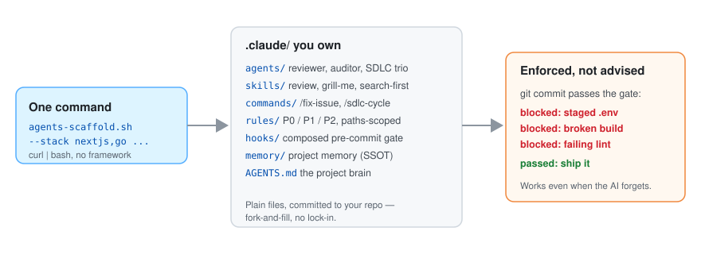

# agents-scaffold

[English](README.md) | [한국어](README.ko.md) | [简体中文](README.zh.md) | 日本語

[](https://github.com/leeyudok/agents-scaffold/actions/workflows/test.yml)
[](LICENSE)
**[leeyudok.github.io/agents-scaffold](https://leeyudok.github.io/agents-scaffold/)**

**AI コーディングエージェント(Claude Code・Codex・Antigravity)のためのガードレール。実際の git pre-commit ゲートで強制します。**

AI コーディングエージェントはルールを破ります。お願いするのではなく、コミットを止めます。

- **何を**: コマンド 1 回で、プロジェクトの頭脳となる `AGENTS.md`、paths スコープのルール、スキル、サブエージェント、
  フック、合成された pre-commit ゲートをリポジトリに入れます。
- **なぜ**: プロンプトにしかないルールは、いずれ無視されます。git フックは交渉に応じません。
- **どうやって**: 生成物はすべて、あなたが所有する普通のファイルです。フレームワークもランタイムもレジストリもありません。

```bash
curl -fsSL https://raw.githubusercontent.com/leeyudok/agents-scaffold/main/bin/agents-scaffold.sh | bash -s -- --lang en --stack nextjs --yes
```


_30秒デモ: コマンド1つ → `AGENTS.md` と Claude Code・Codex・Antigravity の各層 → 実際の git フックがシークレットのコミットをブロック。`vhs docs/assets/demo.tape` で再現できます。_

## こんな覚えがあるなら、これです

- 同じルールを**セッションのたびに説明し直している** — 昨日伝えたことを今日はもう知らない。
- エージェントが `.env` をステージした。型エラーが残ったままコミットが作られた。
- メンバーごとに `CLAUDE.md` がばらばらで、**誰のセッションかで結果が変わる。**
- チームで Claude Code・Codex・Antigravity が混在していて、**全員に共通のルールを 1 セット**にしたい。
- **閉域網や Windows** で作業しているが、大半のエージェント設定はそのどちらも想定していない。

## Quickstart

インストールされるルールとメッセージは韓国語か英語のどちらかです。以下の例はすべて `--lang en` で英語版を入れます。

```bash
# one command, no clone required
# --lang en = English rules and messages; leave it out (or pass --lang ko) for Korean
curl -fsSL https://raw.githubusercontent.com/leeyudok/agents-scaffold/main/bin/agents-scaffold.sh | bash -s -- --lang en --stack nextjs --yes

# or from a local clone (prompts interactively when options are omitted)
git clone https://github.com/leeyudok/agents-scaffold.git
agents-scaffold/bin/agents-scaffold.sh /path/to/repo --lang en --forge github --stack nextjs,bun --name my-app

# Codex or Antigravity too: --harness codex | agy | all
agents-scaffold/bin/agents-scaffold.sh /path/to/repo --lang en --harness all --stack python --yes

# look before you leap: list the stacks, preview the files, print the version
agents-scaffold/bin/agents-scaffold.sh --list-stacks
agents-scaffold/bin/agents-scaffold.sh /path/to/repo --lang en --stack python --dry-run
agents-scaffold/bin/agents-scaffold.sh --version
```

存在しないターゲットディレクトリは作成されます。未知の `--stack` は、有効な名前の一覧を表示してエラーで終わります。
全オプション: [docs/OPTIONS.ja.md](docs/OPTIONS.ja.md#usage-1--script)。

**バージョンを固定し、検証してからインストールする。** `main` から `curl … | bash` すると、その時点の `main` にあるものが
実行されます。リリースタグに固定してダウンロードを検証するには、次の形式を使います。`v1.0.0` は最初のバージョンで、
まだタグは打たれていません。タグができるまでは、自分で確認したコミット SHA を 2 か所に指定してください。
詳細は [SECURITY.md](SECURITY.md#installing-safely) にあります。

```bash
export AGENTS_SCAFFOLD_REF=v1.0.0
export AGENTS_SCAFFOLD_SHA256=<sha256 of that ref's source tarball>
curl -fsSL https://raw.githubusercontent.com/leeyudok/agents-scaffold/v1.0.0/bin/agents-scaffold.sh | bash -s -- --lang en --yes
```

## インストールしたら

インストーラーは最後に、サマリーと同じ手順を表示します。

```bash
# 1. fill in the empty sections of AGENTS.md: Project overview, Stack, Commands

# 2. prove the gate works: this commit must fail with "Blocked"
echo X=1 > .env && git add -f .env && git commit -m test
git rm --cached -q .env && rm .env

# 3. commit what was installed
git add AGENTS.md .claude .agents .gitattributes && git commit -m "chore: add agents-scaffold"

# later
agents-scaffold/bin/agents-scaffold.sh --update .              # refresh; a file you changed gets <file>.new beside it
agents-scaffold/bin/agents-scaffold.sh --update . --dry-run    # preview the refresh
agents-scaffold/bin/agents-scaffold.sh --uninstall . --dry-run # preview removal; --yes removes
```

- インストール時の選択(forge・スタック・言語・ハーネス・スキルセット)は `.claude/.scaffold.json` に記録されます。
  `--update` はその選択を再現して比較するので、スタックプリセット、英語オーバーレイ、`pre-commit.sh` も比較対象です。
  このファイルがなかった頃のインストールは、プロジェクトにあるファイルから選択を推測します。
- 既存のプロジェクトにインストーラーをもう一度実行しても安全です。生成結果と異なる `AGENTS.md` は先に
  `AGENTS.md.bak-<timestamp>` として保存され、スタックゲートが `pre-commit.sh` に二重に挿入されることもありません。
- `--uninstall` が削除するのは、あなたが変更していないファイルだけです。プロジェクトメモリ(`.claude/memory/`)は削除しません。
- うまく動かないときは [docs/TROUBLESHOOTING.en.md](docs/TROUBLESHOOTING.en.md)(英語)を見てください。

## なぜ機能するのか

| 強み | 意味 |
|---|---|
| **プロンプトではなく git で強制** | `.git/hooks/pre-commit` が、ステージングされた `.env` をブロックし、選択したスタックのビルド・型・lint チェックを実行します。どの AI ツールを使っても、人が手でコミットしても同じように掛かります。worktree、submodule、`core.hooksPath` を使うリポジトリでもフックを接続します。 |
| **ソースは 1 つ、エージェントは 3 つ** | `AGENTS.md` が単一の真実の源(SSOT)で、Claude Code・Codex・Antigravity のすべてがネイティブに読みます。スキルは `.agents/skills/` に一度だけ置き、Codex のサブエージェント(`.codex/agents/*.toml`)と Antigravity のルール・サブエージェント・フックは `.claude/` から生成します。 |
| **想定ではなく実測** | ハーネスに関する主張はすべて [docs/harness-matrix.json](docs/harness-matrix.json) の実測値です。Claude Code 2.1.318 は **full** ティア、Codex(codex-cli 0.166.0)と Antigravity(agy 1.5.0)は **baseline** ティアです。baseline ではゲートと `AGENTS.md` は成立し、paths スコープのルールは届きません。full ティアの実測の有効期限が切れると CI が失敗します。 |
| **スタックプリセット 13 種** | Next.js、Spring Boot、Java web(JSP)、Bun、Python、Go、Rust、Ruby on Rails、.NET、PHP Laravel、Android、Flutter、ops — それぞれがルールを追加し、ops 以外は build/lint/test ゲートも追加します。forge は GitHub か GitLab、出力は韓国語か英語。 |
| **paths スコープのルール** | ルールはエージェントがマッチするファイルを触っている間だけロードされるため、すべての規約を先頭ロードせずコンテキストがスリムに保たれます。 |
| **すぐ使えるスキル** | 英語インストールにはワークフロースキル 10 個(review、status、handoff、docs-sync、セキュリティ事前点検 など)が入ります。韓国語インストールには `yd-*` 専門スキル 14 個が加わり、合計 24 個です。[スキル](#スキル)を参照。 |
| **閉域網と Windows に対応** | オフラインバンドルはネットワークなしでインストールでき、Windows は Git Bash と `.cmd` ランチャーで動きます([docs/OFFLINE_INSTALL.en.md](docs/OFFLINE_INSTALL.en.md))。 |
| **元に戻せる** | `--dry-run` は書き込む内容を事前に見せ、`--update` はあなたの編集を上書きせず、`--uninstall` は手を付けていないファイルを取り除きます。 |
| **自己改善** | `skill-evolve` / `agent-evolve` が実際のミスを、それを起こしたスキルやエージェントの「Learned warnings」に変えます。 |
| **テスト済み** | インストーラーの bats リグレッションテスト 100 個以上、スキルごとの契約テスト、ドキュメントのリンクチェッカー。すべて CI で実行。 |

## インストール直後に起きること

エージェント(あるいは人)がシークレットをコミットしようとすると、**コミット自体が通りません。**

```console
$ bash agents-scaffold.sh . --lang en --stack python --name payments --yes
$ echo 'DB_PASSWORD=hunter2' > .env
$ git add -f .env app.py && git commit -m "feat: add config"
Blocked: a .env-type file is staged. Commit is not allowed.
```

ドキュメントに「シークレットをコミットしないこと」と書くのとは違います。止めているのは git フックです。ただしローカルフックは
`git commit --no-verify` で意図的に飛ばせます。ゲートはミスを防ぐ仕組みと捉え、最後の砦は CI に置いてください。

## 何が手に入るか

<picture>
  <source media="(prefers-color-scheme: dark)" srcset="docs/assets/overview-dark.svg">
  
</picture>

インストールの1分後には、エージェントはルールを心得たチームメイトのように振る舞います — プロンプトに不慣れでも大丈夫です:

- **ワークフローがデフォルトになる**: 「ログイン機能を作って」と言えば、エージェントが
  イシュー → ブランチ → 実装 → テスト → PR/MR を自律的に進めます(`/fix-issue`;
  `/sdlc-cycle` は役割分離された3つのエージェントで無人サイクルを実行)。
- **ミスは機構でブロックされる**: `.env` のコミット、壊れたビルドや型エラー、新規 JSP
  スクリプトレットは pre-commit フックが止め、認知的複雑度 15 を超える関数にはフラグが立ちます。
- **階層化されたルール**: P0(絶対 — シークレット、破壊的 SQL、force push)、P1(必須 — イシュー連携、テスト)、
  P2(推奨)— `AGENTS.md` に一度だけ書き、ツールで強制できるところは強制します。
- **Claude Code の権限ルール**: 生成される `settings.json` は `.env` ファイルの読み取り・編集、`rm -rf`、force push を
  拒否し、`git reset --hard` と `git push --force-with-lease` は実行前に確認します。
- **ワンショットコマンド**: `/review`(コードレビュー + セキュリティ監査)、`/status`、`/knowledge-graph`
  (ドキュメントリンクチェッカー)、`/sonar`。
- **要件の鍛え込みは 3 つから選択**: 同梱の **`grill-me`**、または用途に応じて外部ツール 2 つ
  → [要件を鍛えるツールの選び方](docs/OPTIONS.ja.md#要件を鍛えるツールの選び方)。
- **セッションをまたいで生き残るメモリ**: プロジェクトの学びが `.claude/memory/` 配下に蓄積され、
  次のセッションで自動ロードされ、チームで共有されます。
- **チーム/マルチセッションでも安全**: セッションごとの git worktree 分離がデフォルトなので、
  並行するエージェントが互いの作業を踏み荒らすことはありません。

## スキル

| インストール | スキル数 | 内容 |
|---|---|---|
| `--lang en` | 10 | ワークフロースキル: `review`、`status`、`search-first`、`security-precheck`、`docs-sync`、`handoff`、`memory-factcheck`、`skill-evolve`、`grill-me`、そしてテンプレートの `example-skill` |
| `--lang ko`(デフォルト) | 24 | 上記 10 個に `yd-*` 専門スキル 14 個: PostgreSQL、Oracle、SQLite、リレーショナル設計、Go、React、TypeScript、Vite/pnpm ビルド、画面設計、韓国語ライティング、依存関係の CVE 点検 |

`yd-*` スキルは韓国語で書かれているため、英語インストールには入りません。`--with-yd-skills` で英語インストールに追加でき、
`--no-yd-skills` で韓国語インストールから外せます。スキルはスキャフォールドなしでも単独でインストールできます —
Claude Code / Codex のプラグインとして、または `npx skills add LeeYudok/agents-scaffold` で。
詳細は [docs/SKILLS.en.md](docs/SKILLS.en.md)(英語)にあります。

## 比較

製品ではなくカテゴリーの比較です。個別のツールは各行に照らして確認してください。

| | 手書きの `CLAUDE.md` / `AGENTS.md` | 1 ベンダーのランタイム内で動くルールパックやエージェントフレームワーク | agents-scaffold |
|---|---|---|---|
| ルールが強制される場所 | プロンプトの中。モデルは無視できる | そのエージェントのセッション内。フックと権限設定で強制する。セッションの外で作られたコミットは検査されない | `.git/hooks/pre-commit`。どのエージェントにも属さない。人がコミットしても実行される |
| 迂回できるか | 迂回するものがない | そのランタイムの外で作業すればよい | できる — `git commit --no-verify`。最後の砦は CI に置く。スキャフォールドは CI をインストールしない |
| 1 つのリポジトリに複数のエージェント | ツールごとに 1 ファイル、手作業で揃える | 多くは 1 ベンダーのみ | 1 つの `AGENTS.md` を 3 つがネイティブに読み、アダプターは生成される。Codex と Antigravity は baseline ティア |
| インストールしてアップグレードし続けるもの | なし | プラグイン、パッケージ、CLI | 常駐するものはなし。リポジトリにコミットされるファイルはおよそ 60 個(英語)から 190 個(韓国語、`yd-*` スキル込み) |
| 新しいバージョンの取り込み | ファイルを自分で編集する | ベンダーの更新チャネル | `--update`。変更したファイルはそのまま残り、新しい版が `<file>.new` として書き出されるので自分でマージする |
| オフライン/閉域網インストール | ファイル 1 つなので問題ない | レジストリやマーケットプレイスに届くかどうか次第 | オフラインバンドル |

エージェントが 1 つだけの小さなリポジトリなら、手書きのファイルで十分です。ルールをチーム全体に、複数のエージェントに、
どのエージェントのセッションも見ていないコミットにまで守らせる必要があるとき、スキャフォールドが役に立ちます。

## さらに詳しく

| ドキュメント | 内容 |
|---|---|
| [docs/OPTIONS.ja.md](docs/OPTIONS.ja.md) | 全オプション — スタックプリセット 13 種、`--forge`、`--harness`、`--lang`、`--update`、`--uninstall`、`--dry-run`、スキルセット、プレースホルダー置換 |
| [docs/TROUBLESHOOTING.en.md](docs/TROUBLESHOOTING.en.md) | ゲートがコミットを止めた、`AGENTS.md` が無視される、`.new` ファイル、既存のフックや husky、Windows のシンボリックリンク、アンインストール(英語) |
| [docs/SKILLS.en.md](docs/SKILLS.en.md) | スキルセット、プラグインマーケットプレイス、`npx skills`、`install-skills.sh`(英語) |
| [docs/INTERNALS.ja.md](docs/INTERNALS.ja.md) | 内部構造 — 生成される全ツリー、リポジトリ構成、主要パターン |
| [docs/OFFLINE_INSTALL.en.md](docs/OFFLINE_INSTALL.en.md) | 閉域網・Windows インストール — オフラインバンドル、Git Bash、`.cmd` ランチャー、`python3` 設定(英語) |
| [SECURITY.md](SECURITY.md) · [CHANGELOG.md](CHANGELOG.md) | 脆弱性の報告、安全なインストール方法、バージョンごとの変更点(英語) |
| [docs/PRESET_SPEC.md](docs/PRESET_SPEC.md) | スタックプリセットの形式(韓国語) |
| [AGENTS.LEEYUDOK.md](AGENTS.LEEYUDOK.md) | `AGENTS.md` の上に重ねるメンテナー個人のレイヤー — `AGENTS.<NAME>.md` の作成例、ハーネスごとの利用可否、ツールのバージョン。自分のレイヤーは `.claude/scripts/personal-layer.sh on <NAME>` で有効化(韓国語) |
| [dotfiles/](dotfiles/README.md) | メンテナーのマシン用シェル環境(zsh、starship、Claude/Codex/agy ステータスライン)。scaffold のインストールとは別物(韓国語) |

## コントリビュート

ワークフローは [CONTRIBUTING.md](CONTRIBUTING.md)、スタックプリセットの形式は
[docs/PRESET_SPEC.md](docs/PRESET_SPEC.md) を参照してください。初めての方は
[`good first issue`](https://github.com/LeeYudok/agents-scaffold/issues?q=is%3Aissue+is%3Aopen+label%3A%22good+first+issue%22) から始めるのがおすすめです —
レイアウトが完全にテンプレート化されているため、新しいスタックプリセットの追加が最も取り組みやすい課題です。

このリポジトリのルートにある `AGENTS.md` は、インストールされるテンプレートそのものです。そのため `{{PROJECT_NAME}}`
プレースホルダーと空のセクションが残っています。これは意図したものです — 名前はインストーラーが埋め、残りはインストールした人が埋めます。

## ライセンス

MIT — [LICENSE](LICENSE) を参照してください。サードパーティ由来(スキル・ドキュメント)は [CREDITS.md](CREDITS.md) と
[THIRD-PARTY-NOTICES.md](THIRD-PARTY-NOTICES.md) に記載しています。
