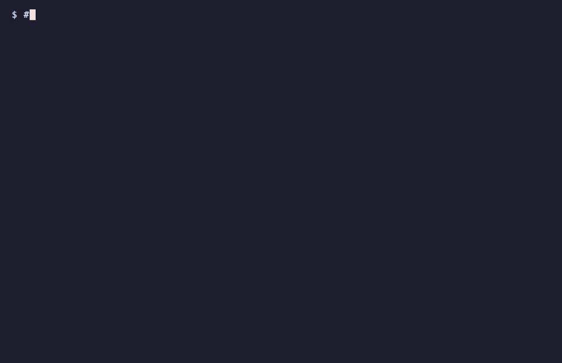
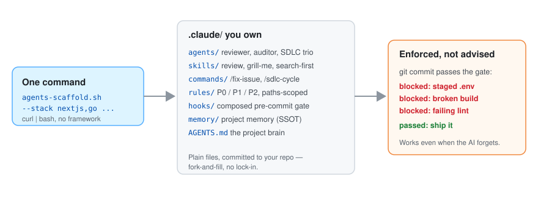

# agents-scaffold

[English](README.md) | 한국어 | [简体中文](README.zh.md) | [日本語](README.ja.md)

[](https://github.com/leeyudok/agents-scaffold/actions/workflows/test.yml)
[](LICENSE)
**[leeyudok.github.io/agents-scaffold](https://leeyudok.github.io/agents-scaffold/)**

**Claude Code·Codex·Antigravity 를 위한 AI 코딩 에이전트 가드레일. 실제 git pre-commit 게이트가 강제한다.**

AI 코딩 에이전트는 규칙을 어긴다. 이 도구는 부탁하지 않고 커밋을 막는다.

- **무엇**: 명령 한 번으로 `AGENTS.md` 프로젝트 브레인, paths 스코프 룰, 스킬, 서브에이전트, 훅, 합성된
  pre-commit 게이트를 레포에 설치한다.
- **왜**: 프롬프트에만 있는 규칙은 언젠가 무시된다. git 훅은 타협하지 않는다.
- **어떻게**: 결과물은 전부 사용자가 소유하는 평범한 파일이다. 프레임워크도 런타임도 레지스트리도 없다.

```bash
curl -fsSL https://raw.githubusercontent.com/leeyudok/agents-scaffold/main/bin/agents-scaffold.sh | bash -s -- --lang en --stack nextjs --yes
```



_30초 데모: 명령 한 번 → `AGENTS.md` 와 Claude Code·Codex·Antigravity 층 → 시크릿 커밋은 실제 git 훅이 차단. 재현은 `vhs docs/assets/demo.tape`._

## 이런 적 있으면 이 도구다

- AI 에게 같은 규칙을 **매 세션 다시 설명**하고 있다. 어제 말한 것을 오늘 또 모른다.
- 에이전트가 `.env` 를 스테이징하거나, 타입 에러가 있는 채로 커밋을 만들었다.
- 팀원마다 `CLAUDE.md` 가 제각각이라 **누구 세션이냐에 따라 결과가 다르다.**
- 팀이 Claude Code·Codex·Antigravity 를 섞어 쓰고, **규칙은 하나로 통일하고 싶다.**
- **폐쇄망이나 Windows** 에서 일하는데, 에이전트 세팅 대부분이 둘 다 고려하지 않는다.

## 퀵스타트

위 명령의 `--lang en` 은 영어 설치다. 한국어 룰·메시지로 받으려면 `--lang en` 을 빼거나 `--lang ko` 를 준다.

```bash
# one command, no clone required
# --lang en = English rules and messages; leave it out (or pass --lang ko) for Korean
curl -fsSL https://raw.githubusercontent.com/leeyudok/agents-scaffold/main/bin/agents-scaffold.sh | bash -s -- --lang en --stack nextjs --yes

# or from a local clone (prompts interactively when options are omitted)
git clone https://github.com/leeyudok/agents-scaffold.git
agents-scaffold/bin/agents-scaffold.sh /path/to/repo --lang en --forge github --stack nextjs,bun --name my-app

# Codex or Antigravity too: --harness codex | agy | all
agents-scaffold/bin/agents-scaffold.sh /path/to/repo --lang en --harness all --stack python --yes

# look before you leap: list the stacks, preview the files, print the version
agents-scaffold/bin/agents-scaffold.sh --list-stacks
agents-scaffold/bin/agents-scaffold.sh /path/to/repo --lang en --stack python --dry-run
agents-scaffold/bin/agents-scaffold.sh --version
```

없는 대상 폴더는 만들어 준다. 모르는 `--stack` 은 올바른 이름 목록과 함께 오류로 끝난다.
전체 옵션은 [docs/OPTIONS.md](docs/OPTIONS.md#사용법-1--스크립트) 에 있다.

**버전을 고정하고 검증해서 설치.** `main` 에서 `curl … | bash` 를 하면 그 순간 `main` 에 있는 것이 실행된다.
릴리스 태그를 고정하고 내려받은 파일을 확인하려면 아래 형식을 쓴다. `v1.0.0` 은 첫 버전이고 아직 태그가 없다.
태그가 생기기 전에는 직접 검토한 커밋 SHA 를 두 자리에 넣는다. 자세한 내용은
[SECURITY.md](SECURITY.md#installing-safely) 에 있다.

```bash
export AGENTS_SCAFFOLD_REF=v1.0.0
export AGENTS_SCAFFOLD_SHA256=<sha256 of that ref's source tarball>
curl -fsSL https://raw.githubusercontent.com/leeyudok/agents-scaffold/v1.0.0/bin/agents-scaffold.sh | bash -s -- --lang en --yes
```

## 설치한 다음

설치가 끝나면 요약과 함께 같은 순서를 알려준다.

```bash
# 1. fill in the empty sections of AGENTS.md: Project overview, Stack, Commands

# 2. prove the gate works: this commit must fail with "Blocked"
echo X=1 > .env && git add -f .env && git commit -m test
git rm --cached -q .env && rm .env

# 3. commit what was installed
git add AGENTS.md .claude .agents .gitattributes && git commit -m "chore: add agents-scaffold"

# later
agents-scaffold/bin/agents-scaffold.sh --update .              # refresh; a file you changed gets <file>.new beside it
agents-scaffold/bin/agents-scaffold.sh --update . --dry-run    # preview the refresh
agents-scaffold/bin/agents-scaffold.sh --uninstall . --dry-run # preview removal; --yes removes
```

- 설치할 때 고른 값(forge·스택·언어·하네스·스킬 묶음)은 `.claude/.scaffold.json` 에 기록된다. `--update` 는 이
  선택을 그대로 재현해 비교하므로 스택 프리셋, 영어 오버레이, `pre-commit.sh` 까지 비교 대상이다. 이 파일이 없던
  시절의 설치는 프로젝트에 있는 파일로 선택을 추론한다.
- 기존 프로젝트에 설치 스크립트를 다시 돌려도 안전하다. 생성본과 다른 `AGENTS.md` 는 먼저
  `AGENTS.md.bak-<timestamp>` 로 저장하고, 스택 게이트를 `pre-commit.sh` 에 두 번 넣지 않는다.
- `--uninstall` 은 사용자가 고치지 않은 파일만 지운다. 프로젝트 메모리(`.claude/memory/`)는 지우지 않는다.
- 뭔가 안 되면 [docs/TROUBLESHOOTING.md](docs/TROUBLESHOOTING.md) 를 본다.

## 왜 믿을 만한가

| 강점 | 의미 |
|---|---|
| **프롬프트가 아니라 git 이 강제** | `.git/hooks/pre-commit` 이 스테이징된 `.env` 를 막고, 선택한 스택의 빌드·타입·린트 검사를 돌린다. 어떤 AI 도구를 쓰든, 사람이 직접 커밋하든 똑같이 걸린다. worktree·submodule·`core.hooksPath` 환경에서도 훅을 연결한다. |
| **원본 하나, 에이전트 셋** | `AGENTS.md` 가 단일 진실원천이고, Claude Code·Codex·Antigravity 모두 이를 네이티브로 읽는다. 스킬은 `.agents/skills/` 에 한 벌만 둔다. Codex 서브에이전트(`.codex/agents/*.toml`)와 Antigravity 룰·서브에이전트·훅은 `.claude/` 에서 생성한다. |
| **가정이 아니라 실측** | 하네스에 관한 주장은 모두 [docs/harness-matrix.json](docs/harness-matrix.json) 의 실측값이다. Claude Code 2.1.318 은 **full** 등급, Codex(codex-cli 0.166.0)와 Antigravity(agy 1.5.0)는 **baseline** 등급이다. baseline 에서는 게이트와 `AGENTS.md` 는 성립하고 paths 스코프 룰은 닿지 않는다. full 등급의 실측이 만료되면 CI 가 실패한다. |
| **스택 프리셋 13종** | Next.js, Spring Boot, Java web(JSP), Bun, Python, Go, Rust, Ruby on Rails, .NET, PHP Laravel, Android, Flutter, ops. 각각 룰을 더하고, ops 를 뺀 나머지는 build/lint/test 게이트도 더한다. forge 는 GitHub 또는 GitLab, 출력 언어는 한국어 또는 영어. |
| **paths 스코프 룰** | 에이전트가 매칭 파일을 만질 때만 룰이 로드된다. 모든 컨벤션을 미리 싣지 않으니 컨텍스트가 가볍다. |
| **기본 제공 스킬** | 영어 설치는 워크플로 스킬 10개(review, status, handoff, docs-sync, 보안 사전점검 등)다. 한국어 설치는 `yd-*` 전문 스킬 14개가 더해져 모두 24개다. [스킬](#스킬) 참조. |
| **폐쇄망·Windows 지원** | 오프라인 번들은 네트워크 없이 설치된다. Windows 는 Git Bash 와 `.cmd` 런처로 돌아간다([docs/OFFLINE_INSTALL.md](docs/OFFLINE_INSTALL.md)). |
| **되돌릴 수 있다** | `--dry-run` 은 무엇을 쓸지 미리 보여주고, `--update` 는 사용자가 고친 파일을 덮어쓰지 않고, `--uninstall` 은 손대지 않은 파일을 도로 걷어낸다. |
| **자기개선** | `skill-evolve` / `agent-evolve` 가 실제 실수를, 그 실수를 낸 스킬·에이전트의 "Learned warnings" 로 바꾼다. |
| **테스트됨** | 설치 스크립트 bats 회귀 테스트 100개 이상, 스킬별 계약 테스트, 문서 링크 체커가 모두 CI 에서 돈다. |

## 설치 직후 이런 일이 벌어진다

에이전트가(또는 사람이) 시크릿을 커밋하려 하면 **커밋 자체가 안 된다.**

```console
$ bash agents-scaffold.sh . --lang en --stack python --name payments --yes
$ echo 'DB_PASSWORD=hunter2' > .env
$ git add -f .env app.py && git commit -m "feat: add config"
Blocked: a .env-type file is staged. Commit is not allowed.
```

문서에 "시크릿 커밋하지 마세요"라고 적어두는 것과 다르다. 막는 것은 git 훅이다. 다만 로컬 훅은
`git commit --no-verify` 로 일부러 건너뛸 수 있다. 게이트는 실수를 막는 장치로 보고, 최종 방어선은 CI 에 둔다.

## 무엇을 얻나

<picture>
  <source media="(prefers-color-scheme: dark)" srcset="docs/assets/overview-dark.svg">
  
</picture>

설치 1분 뒤부터 에이전트가 "규칙을 아는 팀원"처럼 움직인다. 프롬프트를 잘 몰라도 된다.

- **워크플로가 기본값**: "로그인 기능 만들어줘" 한 마디에 이슈 등록 → 브랜치 → 구현 →
  테스트 → PR/MR 까지 스스로 따른다(`/fix-issue`. `/sdlc-cycle` 은 역할을 나눈 에이전트 3개가
  무인 사이클을 돈다).
- **실수는 기계가 차단**: `.env` 커밋, 타입 에러나 빌드가 깨진 커밋, 신규 JSP 스크립틀릿은
  pre-commit 훅이 막고, 인지 복잡도 15 초과 함수는 경고한다.
- **티어별 규칙**: P0(절대 — 시크릿, 파괴적 SQL, force push), P1(필수 — 이슈 연결, 테스트),
  P2(권장). `AGENTS.md` 에 한 번 적고, 도구로 강제할 수 있는 곳에서는 강제한다.
- **Claude Code 권한 규칙**: 생성된 `settings.json` 이 `.env` 읽기·수정, `rm -rf`, force push 를 거부하고,
  `git reset --hard` 와 `git push --force-with-lease` 는 실행 전에 묻는다.
- **명령 한 번으로**: `/review`(코드리뷰+보안감사), `/status`,
  `/knowledge-graph`(문서 링크 검사), `/sonar`.
- **요구사항 다지기는 셋 중 골라서**: 동봉된 **`grill-me`** 외에 외부 도구 둘을 상황에
  맞게 붙일 수 있다 → [요구사항 다지기 도구 고르기](docs/OPTIONS.md#요구사항-다지기-도구-고르기).
- **세션이 끝나도 기억**: `.claude/memory/` 에 프로젝트에서 배운 것이 쌓여 다음 세션에 자동
  로드되고 팀과 공유된다.
- **팀/멀티세션 안전**: 세션마다 git worktree 격리가 기본이라 병렬 에이전트가 서로의 작업을
  덮어쓰지 않는다.

## 스킬

| 설치 | 스킬 | 내용 |
|---|---|---|
| `--lang en` | 10 | 워크플로 스킬: `review`, `status`, `search-first`, `security-precheck`, `docs-sync`, `handoff`, `memory-factcheck`, `skill-evolve`, `grill-me`, 그리고 `example-skill` 템플릿 |
| `--lang ko` (기본) | 24 | 위 10개에 `yd-*` 전문 스킬 14개: PostgreSQL, Oracle, SQLite, 관계형 설계, Go, React, TypeScript, Vite/pnpm 빌드, 화면설계, 한국어 글쓰기, 의존성 CVE 점검 |

`yd-*` 스킬은 한국어로 쓰여 있어서 영어 설치에는 넣지 않는다. `--with-yd-skills` 는 영어 설치에 넣고,
`--no-yd-skills` 는 한국어 설치에서 뺀다. 스킬은 스캐폴드 없이 따로 설치할 수도 있다. Claude Code / Codex
플러그인으로 받거나 `npx skills add LeeYudok/agents-scaffold` 를 쓴다.
자세한 내용은 [docs/SKILLS.md](docs/SKILLS.md) 에 있다.

## 비교

제품이 아니라 유형끼리 견준 표다. 특정 도구는 각 행에 직접 대어 본다.

| | 직접 쓴 `CLAUDE.md` / `AGENTS.md` | 한 벤더의 런타임 안에서 도는 룰 팩·에이전트 프레임워크 | agents-scaffold |
|---|---|---|---|
| 규칙을 강제하는 곳 | 프롬프트. 모델이 무시할 수 있다 | 그 에이전트 세션 안. 훅과 권한 설정으로 강제한다. 세션 밖에서 만든 커밋은 검사하지 않는다 | `.git/hooks/pre-commit`. 어떤 에이전트에도 속하지 않는다. 사람이 커밋해도 돈다 |
| 우회할 수 있나 | 우회할 것이 없다 | 그 런타임 밖에서 작업하면 된다 | 된다 — `git commit --no-verify`. 최종 방어선은 CI 에 둔다. 스캐폴드는 CI 를 설치하지 않는다 |
| 한 레포에 에이전트 여럿 | 도구마다 파일 하나, 손으로 맞춘다 | 대개 한 벤더 전용 | `AGENTS.md` 하나를 셋이 네이티브로 읽고, 어댑터는 생성한다. Codex 와 Antigravity 는 baseline 등급이다 |
| 설치하고 계속 올려야 하는 것 | 없음 | 플러그인·패키지·CLI | 실행되는 것은 없다. 레포에 커밋되는 파일이 대략 60개(영어)에서 190개(한국어, `yd-*` 스킬 포함)다 |
| 새 버전 받기 | 파일을 직접 고친다 | 벤더의 업데이트 채널 | `--update`. 사용자가 고친 파일은 그대로 두고 새 버전을 `<file>.new` 로 써서 직접 합치게 한다 |
| 오프라인 / 폐쇄망 설치 | 파일 하나라 문제없다 | 레지스트리나 마켓플레이스에 닿아야 한다 | 오프라인 번들 |

에이전트 하나를 쓰는 작은 레포라면 직접 쓴 파일로 충분하다. 규칙이 팀 전체에, 둘 이상의 에이전트에, 에이전트
세션이 보지 못하는 커밋에까지 지켜져야 할 때 스캐폴드가 값을 한다.

## 더 보기

| 문서 | 내용 |
|---|---|
| [docs/OPTIONS.md](docs/OPTIONS.md) | 전체 옵션 — 스택 프리셋 13종, `--forge`, `--harness`, `--lang`, `--update`, `--uninstall`, `--dry-run`, 스킬 묶음, 치환 플레이스홀더 |
| [docs/TROUBLESHOOTING.md](docs/TROUBLESHOOTING.md) | 게이트가 커밋을 막았다, `AGENTS.md` 를 읽지 않는다, `.new` 파일, 기존 훅·husky, Windows 심볼릭 링크, 제거 |
| [docs/SKILLS.md](docs/SKILLS.md) | 스킬 묶음, 플러그인 마켓플레이스, `npx skills`, `install-skills.sh` |
| [docs/INTERNALS.md](docs/INTERNALS.md) | 내부 구조 — 생성되는 전체 트리, 레포 구성, 주요 패턴 |
| [docs/OFFLINE_INSTALL.md](docs/OFFLINE_INSTALL.md) | 폐쇄망·Windows 설치 — 오프라인 번들, Git Bash, `.cmd` 런처, `python3` 설정 |
| [SECURITY.md](SECURITY.md) · [CHANGELOG.md](CHANGELOG.md) | 취약점 제보, 안전하게 설치하기, 버전별 변경 내역(영어) |
| [docs/PRESET_SPEC.md](docs/PRESET_SPEC.md) | 스택 프리셋 규격 |
| [AGENTS.LEEYUDOK.md](AGENTS.LEEYUDOK.md) | `AGENTS.md` 위에 얹는 메인테이너 개인 레이어 — `AGENTS.<NAME>.md` 작성 예시, 하네스별 사용 가능성, 도구 버전. 자기 레이어는 `.claude/scripts/personal-layer.sh on <NAME>` 으로 켠다 |
| [dotfiles/](dotfiles/README.md) | 메인테이너의 머신 셸 환경(zsh·starship·Claude/Codex/agy statusline). scaffold 설치와는 별개다 |

## Contributing

워크플로는 [CONTRIBUTING.md](CONTRIBUTING.md), 스택 프리셋 규격은 [docs/PRESET_SPEC.md](docs/PRESET_SPEC.md) 를 본다.
처음이라면 [`good first issue`](https://github.com/LeeYudok/agents-scaffold/issues?q=is%3Aissue+is%3Aopen+label%3A%22good+first+issue%22) 라벨부터 본다.
새 스택 프리셋 추가가 구조가 정형화돼 있어 가장 쉽다.

이 저장소 루트의 `AGENTS.md` 는 설치되는 템플릿이다. 그래서 `{{PROJECT_NAME}}` 플레이스홀더와 빈 섹션이 그대로
남아 있다. 의도한 상태다. 이름은 설치 스크립트가 채우고 나머지는 설치한 사람이 채운다.

## License

MIT — [LICENSE](LICENSE) 참조. 서드파티 유래(스킬·문서)는 [CREDITS.md](CREDITS.md) 와
[THIRD-PARTY-NOTICES.md](THIRD-PARTY-NOTICES.md) 에 있다.
