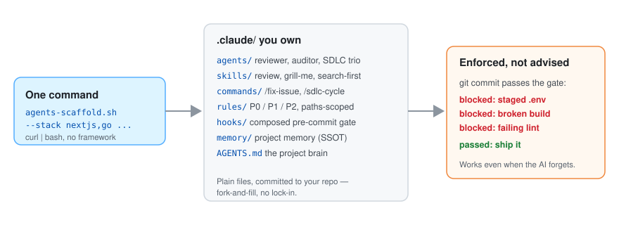

# agents-scaffold

English | [한국어](README.ko.md) | [简体中文](README.zh.md) | [日本語](README.ja.md)

[](https://github.com/leeyudok/agents-scaffold/actions/workflows/test.yml)
[](LICENSE)
**[leeyudok.github.io/agents-scaffold](https://leeyudok.github.io/agents-scaffold/)**

**Guardrails for AI coding agents — Claude Code, Codex and Antigravity — enforced by a real git pre-commit gate.**

AI coding agents break your rules. This blocks the commit instead of asking nicely.

- **What**: one command installs an `AGENTS.md` project brain, path-scoped rules, skills, subagents, hooks and a
  composed pre-commit gate into your repo.
- **Why**: a rule that lives only in a prompt gets ignored eventually. A git hook does not negotiate.
- **How**: plain files you own outright. No framework, no runtime, no registry.

```bash
curl -fsSL https://raw.githubusercontent.com/leeyudok/agents-scaffold/main/bin/agents-scaffold.sh | bash -s -- --lang en --stack nextjs --yes
```


_30-second demo: one command → `AGENTS.md` plus Claude Code, Codex and Antigravity layers → the real git hook blocks a secret commit. Reproduce with `vhs docs/assets/demo.tape`._

## You want this if

- You **re-explain the same rules every session** — what you told the agent yesterday is gone today.
- An agent staged your `.env`, or produced a commit with type errors still in it.
- Every teammate has a different `CLAUDE.md`, so **results depend on whose session it was.**
- Your team mixes Claude Code, Codex and Antigravity, and you want **one set of rules for all of them.**
- You work on an **air-gapped network or Windows** and most agent setups assume neither.

## Quickstart

```bash
# one command, no clone required
# --lang en = English rules and messages; leave it out (or pass --lang ko) for Korean
curl -fsSL https://raw.githubusercontent.com/leeyudok/agents-scaffold/main/bin/agents-scaffold.sh | bash -s -- --lang en --stack nextjs --yes

# or from a local clone (prompts interactively when options are omitted)
git clone https://github.com/leeyudok/agents-scaffold.git
agents-scaffold/bin/agents-scaffold.sh /path/to/repo --lang en --forge github --stack nextjs,bun --name my-app

# Codex or Antigravity too: --harness codex | agy | all
agents-scaffold/bin/agents-scaffold.sh /path/to/repo --lang en --harness all --stack python --yes

# look before you leap: list the stacks, preview the files, print the version
agents-scaffold/bin/agents-scaffold.sh --list-stacks
agents-scaffold/bin/agents-scaffold.sh /path/to/repo --lang en --stack python --dry-run
agents-scaffold/bin/agents-scaffold.sh --version
```

A target directory that does not exist is created. An unknown `--stack` is an error that lists the valid names.
Every option: [docs/OPTIONS.en.md](docs/OPTIONS.en.md#usage-1--script).

**Pinned, verified install.** `curl … | bash` from `main` runs whatever is on `main` at that moment. To pin a
release tag and check the download, use the form below (`v1.0.0` is the first version and is not tagged yet — until
it is, pin a commit SHA you have reviewed in both places). Details: [SECURITY.md](SECURITY.md#installing-safely).

```bash
export AGENTS_SCAFFOLD_REF=v1.0.0
export AGENTS_SCAFFOLD_SHA256=<sha256 of that ref's source tarball>
curl -fsSL https://raw.githubusercontent.com/leeyudok/agents-scaffold/v1.0.0/bin/agents-scaffold.sh | bash -s -- --lang en --yes
```

## After install

The installer ends with a summary and these same steps.

```bash
# 1. fill in the empty sections of AGENTS.md: Project overview, Stack, Commands

# 2. prove the gate works: this commit must fail with "Blocked"
echo X=1 > .env && git add -f .env && git commit -m test
git rm --cached -q .env && rm .env

# 3. commit what was installed
git add AGENTS.md .claude .agents .gitattributes && git commit -m "chore: add agents-scaffold"

# later
agents-scaffold/bin/agents-scaffold.sh --update .              # refresh; a file you changed gets <file>.new beside it
agents-scaffold/bin/agents-scaffold.sh --update . --dry-run    # preview the refresh
agents-scaffold/bin/agents-scaffold.sh --uninstall . --dry-run # preview removal; --yes removes
```

- The choices you made (forge, stacks, language, harness, skill sets) are recorded in `.claude/.scaffold.json`.
  `--update` replays them, so stack presets, the English overlay and `pre-commit.sh` are compared too. An install
  from before that file existed is inferred from what is in the project.
- Running the installer again over a project is safe: an `AGENTS.md` that differs from the generated one is saved as
  `AGENTS.md.bak-<timestamp>` first, and stack gates are not spliced into `pre-commit.sh` twice.
- `--uninstall` removes only the files you did not change. Project memory (`.claude/memory/`) is never removed.
- Something not working? [docs/TROUBLESHOOTING.en.md](docs/TROUBLESHOOTING.en.md).

## Why it holds up

| Strength | What it means |
|---|---|
| **Enforced by git, not by prompts** | `.git/hooks/pre-commit` blocks a staged `.env` and runs the selected stack's build, type or lint check. It holds whichever AI tool you use — and when a human commits by hand. The hook is wired in worktrees, submodules and under `core.hooksPath` too. |
| **One source, three agents** | `AGENTS.md` is the single source of truth; Claude Code, Codex and Antigravity all read it natively. Skills live once in `.agents/skills/`; Codex subagents (`.codex/agents/*.toml`), Antigravity rules, subagents and hooks are generated from `.claude/`. |
| **Measured, not assumed** | Every harness claim is a live measurement in [docs/harness-matrix.json](docs/harness-matrix.json): Claude Code 2.1.318 is at the **full** tier; Codex (codex-cli 0.166.0) and Antigravity (agy 1.5.0) are at **baseline** — the gate and `AGENTS.md` hold, path-scoped rules do not reach them. CI fails when a full-tier measurement expires. |
| **13 stack presets** | Next.js, Spring Boot, Java web (JSP), Bun, Python, Go, Rust, Ruby on Rails, .NET, PHP Laravel, Android, Flutter, ops — each adds rules, and all but ops add a build/lint/test gate. GitHub or GitLab forge, Korean or English output. |
| **Path-scoped rules** | A rule loads only while the agent touches matching files, so context stays lean instead of front-loading every convention. |
| **Skills out of the box** | 10 workflow skills in an English install (review, status, handoff, docs-sync, security pre-check, ...). A Korean install adds 14 `yd-*` expert skills, 24 in total. See [Skills](#skills). |
| **Air-gapped and Windows ready** | An offline bundle installs with no network; Windows runs through Git Bash with a `.cmd` launcher ([docs/OFFLINE_INSTALL.en.md](docs/OFFLINE_INSTALL.en.md)). |
| **Reversible** | `--dry-run` shows what would be written, `--update` never overwrites your edits, `--uninstall` takes the untouched files back out. |
| **Self-improving** | `skill-evolve` / `agent-evolve` turn real mistakes into "Learned warnings" in the skill or agent that made them. |
| **Tested** | 100+ bats regression tests for the installer, per-skill contract tests, a link checker for the docs, all in CI. |

## What happens the moment it's installed

When an agent — or a person — tries to commit a secret, **the commit does not happen.**

```console
$ bash agents-scaffold.sh . --lang en --stack python --name payments --yes
$ echo 'DB_PASSWORD=hunter2' > .env
$ git add -f .env app.py && git commit -m "feat: add config"
Blocked: a .env-type file is staged. Commit is not allowed.
```

This is not the same as writing "don't commit secrets" in a doc. A git hook is what stops it. A local hook can still
be skipped on purpose with `git commit --no-verify`, so treat the gate as a guard against mistakes and keep CI as the
backstop.

## What you get

<picture>
  <source media="(prefers-color-scheme: dark)" srcset="docs/assets/overview-dark.svg">
  
</picture>

One minute after install, the agent behaves like a teammate who knows the rules — even if you're new to prompting:

- **The workflow is the default**: say "build the login feature" and the agent follows
  issue → branch → implementation → tests → PR/MR on its own (`/fix-issue`;
  `/sdlc-cycle` runs an unattended cycle with three role-separated agents).
- **Mistakes are blocked by machinery**: committing a `.env`, a broken build or type errors, or new JSP
  scriptlets is stopped by the pre-commit hook, and functions over cognitive complexity 15 get flagged.
- **Tiered rules**: P0 (absolute — secrets, destructive SQL, force push), P1 (required — issue links, tests),
  P2 (recommended) — written once in `AGENTS.md`, enforced where a tool can enforce them.
- **Permission rules for Claude Code**: the generated `settings.json` denies reading or editing `.env` files,
  `rm -rf` and force pushes, and asks before `git reset --hard` and `git push --force-with-lease`.
- **One-shot commands**: `/review` (code review + security audit), `/status`, `/knowledge-graph`
  (doc link checker), `/sonar`.
- **Requirements hardening, your pick of three**: the bundled **`grill-me`**, or two external tools depending on
  the job → [Picking a requirements-hardening tool](docs/OPTIONS.en.md#picking-a-requirements-hardening-tool).
- **Memory that survives sessions**: project learnings accumulate under `.claude/memory/`, load automatically
  next session, and are shared with the team.
- **Team and multi-session safe**: per-session git worktree isolation is the default, so parallel agents never
  trample each other's work.

## Skills

| Install | Skills | What they are |
|---|---|---|
| `--lang en` | 10 | Workflow skills: `review`, `status`, `search-first`, `security-precheck`, `docs-sync`, `handoff`, `memory-factcheck`, `skill-evolve`, `grill-me`, and the `example-skill` template |
| `--lang ko` (default) | 24 | The same 10 plus 14 `yd-*` expert skills: PostgreSQL, Oracle, SQLite, relational design, Go, React, TypeScript, Vite/pnpm builds, screen design, Korean writing, dependency CVE checks |

The `yd-*` skills are written in Korean, so an English install leaves them out. `--with-yd-skills` adds them to an
English install and `--no-yd-skills` drops them from a Korean one. The skills also install on their own, without the
scaffold — as a Claude Code / Codex plugin or with `npx skills add LeeYudok/agents-scaffold`.
Details: [docs/SKILLS.en.md](docs/SKILLS.en.md).

## How it compares

Categories, not products — check any specific tool against the rows.

| | A hand-written `CLAUDE.md` / `AGENTS.md` | Rule packs and agent frameworks that live inside one vendor's runtime | agents-scaffold |
|---|---|---|---|
| Where a rule is enforced | In the prompt. The model can ignore it | Inside that agent's session, through its hooks and permissions. A commit made outside the session is not checked | In `.git/hooks/pre-commit`, outside any agent. It also runs when a person commits |
| Can it be bypassed | Nothing to bypass | Work outside that runtime | Yes — `git commit --no-verify`. Keep CI as the backstop; the scaffold does not install CI |
| Several agents on one repo | One file per tool, kept in step by hand | Typically one vendor | One `AGENTS.md` read natively by three; adapters generated. Codex and Antigravity are at the baseline tier |
| What you install and keep upgrading | Nothing | A plugin, package or CLI | Nothing running. Roughly 60 files (English) to 190 (Korean, with `yd-*` skills) committed to your repo |
| Getting new versions | You edit the file | The vendor's update channel | `--update`; a file you changed is left alone and the new one is written as `<file>.new` for you to merge |
| Offline / air-gapped install | It is just a file | Depends on reaching its registry or marketplace | An offline bundle |

A hand-written file is the right answer for a small repo with one agent. The scaffold earns its keep when the rules
have to hold for a team, for more than one agent, or for commits no agent session sees.

## Going further

| Doc | What's in it |
|---|---|
| [docs/OPTIONS.en.md](docs/OPTIONS.en.md) | Every option — 13 stack presets, `--forge`, `--harness`, `--lang`, `--update`, `--uninstall`, `--dry-run`, skill sets, placeholder substitution |
| [docs/TROUBLESHOOTING.en.md](docs/TROUBLESHOOTING.en.md) | The gate blocked a commit, `AGENTS.md` is ignored, `.new` files, an existing hook or husky, Windows symlinks, uninstall |
| [docs/SKILLS.en.md](docs/SKILLS.en.md) | Skill sets, the plugin marketplace, `npx skills`, `install-skills.sh` |
| [docs/INTERNALS.en.md](docs/INTERNALS.en.md) | Internals — the full generated tree, repository layout, key patterns |
| [docs/OFFLINE_INSTALL.en.md](docs/OFFLINE_INSTALL.en.md) | Air-gapped and Windows install — offline bundle, Git Bash, `.cmd` launcher, `python3` setup |
| [SECURITY.md](SECURITY.md) · [CHANGELOG.md](CHANGELOG.md) | Reporting a vulnerability, installing safely, what changed in each version |
| [docs/PRESET_SPEC.md](docs/PRESET_SPEC.md) | Stack preset format (Korean) |
| [AGENTS.LEEYUDOK.md](AGENTS.LEEYUDOK.md) | The maintainer's personal layer on top of `AGENTS.md` — a worked `AGENTS.<NAME>.md` example, per-harness availability, tool versions. Turn your own on with `.claude/scripts/personal-layer.sh on <NAME>` (Korean) |
| [dotfiles/](dotfiles/README.md) | The maintainer's machine shell setup (zsh, starship, Claude/Codex/agy status lines). Separate from the scaffold install (Korean) |

## Contributing

See [CONTRIBUTING.md](CONTRIBUTING.md) for the workflow and [docs/PRESET_SPEC.md](docs/PRESET_SPEC.md) for the
stack preset format. New here? Start with a
[`good first issue`](https://github.com/LeeYudok/agents-scaffold/issues?q=is%3Aissue+is%3Aopen+label%3A%22good+first+issue%22) —
adding a new stack preset is the most approachable one, since the layout is fully templated.

The `AGENTS.md` at the root of this repository is the template that gets installed, so it still contains
`{{PROJECT_NAME}}` placeholders and empty sections. That is intended — the installer fills in the name, and the
person installing fills in the rest.

## License

MIT — see [LICENSE](LICENSE). Third-party origins (skills, docs) are listed in [CREDITS.md](CREDITS.md) and
[THIRD-PARTY-NOTICES.md](THIRD-PARTY-NOTICES.md).
