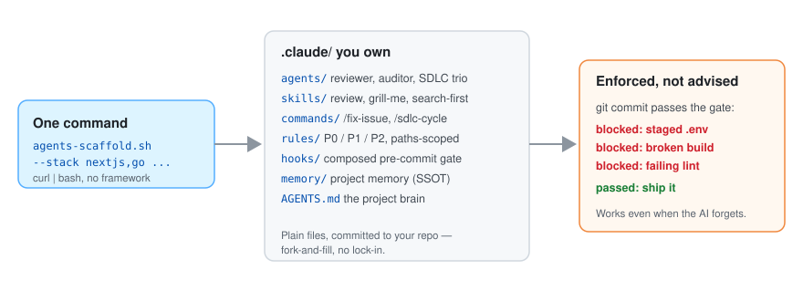

# agents-scaffold

[English](README.md) | [한국어](README.ko.md) | 简体中文 | [日本語](README.ja.md)

[](https://github.com/leeyudok/agents-scaffold/actions/workflows/test.yml)
[](LICENSE)
**[leeyudok.github.io/agents-scaffold](https://leeyudok.github.io/agents-scaffold/)**

**为 AI 编码代理（Claude Code、Codex、Antigravity）设置护栏，由真正的 git pre-commit 门禁强制执行。**

AI 编码代理不守规则。这个工具不是好言相劝，而是直接拦下提交。

- **是什么**：一条命令，把作为项目大脑的 `AGENTS.md`、按路径作用域加载的规则、技能、子代理、钩子以及组合而成的
  pre-commit 门禁装进你的仓库。
- **为什么**：只写在提示词里的规则，迟早会被无视。git 钩子不讲情面。
- **怎么做**：产物全是归你所有的普通文件。没有框架、没有运行时、没有注册中心。

```bash
curl -fsSL https://raw.githubusercontent.com/leeyudok/agents-scaffold/main/bin/agents-scaffold.sh | bash -s -- --lang en --stack nextjs --yes
```


_30 秒演示：一条命令 → `AGENTS.md` 加上 Claude Code、Codex 和 Antigravity 各自的层 → 真实的 git 钩子拦截了一次泄露密钥的提交。可用 `vhs docs/assets/demo.tape` 复现。_

## 如果你遇到过这些，就该用它

- 你在**每个会话里重复讲同样的规则** — 昨天告诉代理的，今天又忘了。
- 代理把 `.env` 加进了暂存区，或者带着类型错误就生成了提交。
- 每个同事的 `CLAUDE.md` 都不一样，**结果取决于是谁的会话。**
- 团队混用 Claude Code、Codex 和 Antigravity，你希望**用一套规则管住所有代理。**
- 你在**内网（离线）或 Windows** 上工作，而大多数代理配置对这两者都不支持。

## Quickstart

安装产物（规则和提示信息）只有韩文和英文两种。下面的示例都用 `--lang en` 安装英文版。

```bash
# one command, no clone required
# --lang en = English rules and messages; leave it out (or pass --lang ko) for Korean
curl -fsSL https://raw.githubusercontent.com/leeyudok/agents-scaffold/main/bin/agents-scaffold.sh | bash -s -- --lang en --stack nextjs --yes

# or from a local clone (prompts interactively when options are omitted)
git clone https://github.com/leeyudok/agents-scaffold.git
agents-scaffold/bin/agents-scaffold.sh /path/to/repo --lang en --forge github --stack nextjs,bun --name my-app

# Codex or Antigravity too: --harness codex | agy | all
agents-scaffold/bin/agents-scaffold.sh /path/to/repo --lang en --harness all --stack python --yes

# look before you leap: list the stacks, preview the files, print the version
agents-scaffold/bin/agents-scaffold.sh --list-stacks
agents-scaffold/bin/agents-scaffold.sh /path/to/repo --lang en --stack python --dry-run
agents-scaffold/bin/agents-scaffold.sh --version
```

目标目录不存在时会自动创建。`--stack` 写错会报错并列出可用的名称。
完整选项见 [docs/OPTIONS.zh.md](docs/OPTIONS.zh.md#usage-1--脚本)。

**固定版本并校验后再安装。** 从 `main` 执行 `curl … | bash`，运行的就是那一刻 `main` 上的内容。
要固定到发布标签并校验下载内容，请用下面的写法。`v1.0.0` 是第一个版本，目前还没有打标签；
在打标签之前，请在两处都填入你审阅过的提交 SHA。详见 [SECURITY.md](SECURITY.md#installing-safely)。

```bash
export AGENTS_SCAFFOLD_REF=v1.0.0
export AGENTS_SCAFFOLD_SHA256=<sha256 of that ref's source tarball>
curl -fsSL https://raw.githubusercontent.com/leeyudok/agents-scaffold/v1.0.0/bin/agents-scaffold.sh | bash -s -- --lang en --yes
```

## 安装之后

安装结束时会打印摘要和同样的步骤。

```bash
# 1. fill in the empty sections of AGENTS.md: Project overview, Stack, Commands

# 2. prove the gate works: this commit must fail with "Blocked"
echo X=1 > .env && git add -f .env && git commit -m test
git rm --cached -q .env && rm .env

# 3. commit what was installed
git add AGENTS.md .claude .agents .gitattributes && git commit -m "chore: add agents-scaffold"

# later
agents-scaffold/bin/agents-scaffold.sh --update .              # refresh; a file you changed gets <file>.new beside it
agents-scaffold/bin/agents-scaffold.sh --update . --dry-run    # preview the refresh
agents-scaffold/bin/agents-scaffold.sh --uninstall . --dry-run # preview removal; --yes removes
```

- 安装时的选择（forge、技术栈、语言、harness、技能包）记录在 `.claude/.scaffold.json` 中。`--update`
  会按这些选择重新生成并比较，因此技术栈预设、英文覆盖层和 `pre-commit.sh` 也在比较范围内。
  没有这个文件的旧安装，会根据项目中现有的文件推断出当时的选择。
- 在已有项目上再次运行安装器是安全的：与生成结果不同的 `AGENTS.md` 会先保存为
  `AGENTS.md.bak-<timestamp>`，技术栈门禁也不会被重复插入 `pre-commit.sh`。
- `--uninstall` 只删除你没有改过的文件。项目记忆（`.claude/memory/`）永远不会被删除。
- 遇到问题？见 [docs/TROUBLESHOOTING.en.md](docs/TROUBLESHOOTING.en.md)（英文）。

## 为什么靠得住

| 优势 | 含义 |
|---|---|
| **由 git 强制，而非靠提示词** | `.git/hooks/pre-commit` 会拦截暂存的 `.env`，并运行所选技术栈的构建、类型或 lint 检查。无论你用哪个 AI 工具，乃至人手动提交，它都一样生效。在 worktree、submodule 和设置了 `core.hooksPath` 的仓库里，钩子同样会接好。 |
| **一个源头，三个代理** | `AGENTS.md` 是单一事实来源（SSOT），Claude Code、Codex 和 Antigravity 都原生读取它。技能只在 `.agents/skills/` 存放一份；Codex 子代理（`.codex/agents/*.toml`）以及 Antigravity 的规则、子代理和钩子都由 `.claude/` 生成。 |
| **实测，而非假设** | 每一条关于 harness 的说法都是 [docs/harness-matrix.json](docs/harness-matrix.json) 中的实测记录：Claude Code 2.1.318 为 **full** 级别；Codex（codex-cli 0.166.0）和 Antigravity（agy 1.5.0）为 **baseline** — 门禁和 `AGENTS.md` 生效，按路径作用域加载的规则到不了它们。full 级别的实测记录过期时 CI 会失败。 |
| **13 种技术栈预设** | Next.js、Spring Boot、Java web（JSP）、Bun、Python、Go、Rust、Ruby on Rails、.NET、PHP Laravel、Android、Flutter、ops — 每种都会添加规则，除 ops 外还各自添加 build/lint/test 门禁。支持 GitHub 或 GitLab forge，输出可选韩文或英文。 |
| **按路径作用域加载的规则** | 规则只在代理触碰匹配文件时才加载，上下文保持精简，而不是一开始就灌入全部约定。 |
| **开箱即用的技能** | 英文安装包含 10 个工作流技能（review、status、handoff、docs-sync、安全预检等）。韩文安装再加上 14 个 `yd-*` 专家技能，共 24 个。见[技能](#技能)。 |
| **支持内网与 Windows** | 离线包无需网络即可安装；Windows 通过 Git Bash 和 `.cmd` 启动器运行（[docs/OFFLINE_INSTALL.en.md](docs/OFFLINE_INSTALL.en.md)）。 |
| **可以回退** | `--dry-run` 先展示将要写入的内容，`--update` 不会覆盖你的修改，`--uninstall` 会把没动过的文件原样撤走。 |
| **自我改进** | `skill-evolve` / `agent-evolve` 会把真实错误提炼成 "Learned warnings"，写回犯错的那个技能或代理。 |
| **经过测试** | 安装器有 100 多个 bats 回归测试，每个技能有契约测试，文档有链接检查器，全部在 CI 中运行。 |

## 装好之后会发生什么

当代理（或人）试图提交密钥时，**提交根本不会发生。**

```console
$ bash agents-scaffold.sh . --lang en --stack python --name payments --yes
$ echo 'DB_PASSWORD=hunter2' > .env
$ git add -f .env app.py && git commit -m "feat: add config"
Blocked: a .env-type file is staged. Commit is not allowed.
```

这与在文档里写一句"不要提交密钥"完全不同。拦下它的是 git 钩子。不过本地钩子可以用
`git commit --no-verify` 有意跳过，所以请把门禁当作防止失误的手段，把 CI 留作最后一道防线。

## 你会得到什么

<picture>
  <source media="(prefers-color-scheme: dark)" srcset="docs/assets/overview-dark.svg">
  
</picture>

安装一分钟后，代理的表现就像一位熟知规则的同事。即使你刚接触 prompt 编写也没关系：

- **工作流即默认行为**：只要说"实现登录功能"，代理就会自行遵循
  issue → 分支 → 实现 → 测试 → PR/MR 的流程（`/fix-issue`；
  `/sdlc-cycle` 由三个职责分离的 agent 无人值守地跑完一个完整周期）。
- **错误由机制拦截**：提交 `.env`、构建失败或类型错误、新增 JSP
  scriptlet 都会被 pre-commit 钩子拦下，认知复杂度超过 15 的函数会被标记。
- **分级规则**：P0（绝对 — 密钥、破坏性 SQL、force push）、P1（必需 — 关联 issue、测试）、
  P2（推荐）— 在 `AGENTS.md` 中只写一次，凡是工具能强制的地方就强制执行。
- **Claude Code 权限规则**：生成的 `settings.json` 拒绝读取或编辑 `.env` 文件、`rm -rf` 和 force push，
  并在执行 `git reset --hard` 和 `git push --force-with-lease` 之前先询问。
- **一键命令**：`/review`（代码评审 + 安全审计）、`/status`、`/knowledge-graph`
  （文档链接检查器）、`/sonar`。
- **需求打磨，三种方式任选**：内置的 **`grill-me`**，或按场景选用两个外部工具 →
  [挑选需求打磨工具](docs/OPTIONS.zh.md#挑选需求打磨工具)。
- **跨会话留存的记忆**：项目经验持续沉淀在 `.claude/memory/` 下，下次会话自动加载，
  并与团队共享。
- **团队/多会话安全**：默认按会话隔离 git worktree，并行的代理互不踩踏。

## 技能

| 安装方式 | 技能数 | 内容 |
|---|---|---|
| `--lang en` | 10 | 工作流技能：`review`、`status`、`search-first`、`security-precheck`、`docs-sync`、`handoff`、`memory-factcheck`、`skill-evolve`、`grill-me`，以及模板 `example-skill` |
| `--lang ko`（默认） | 24 | 上述 10 个加上 14 个 `yd-*` 专家技能：PostgreSQL、Oracle、SQLite、关系型设计、Go、React、TypeScript、Vite/pnpm 构建、界面设计、韩文写作、依赖 CVE 检查 |

`yd-*` 技能是用韩文写的，所以英文安装不包含它们。`--with-yd-skills` 可以把它们加进英文安装，
`--no-yd-skills` 则从韩文安装中去掉。这些技能也可以脱离脚手架单独安装 — 作为 Claude Code / Codex 插件，
或者用 `npx skills add LeeYudok/agents-scaffold`。
详见 [docs/SKILLS.en.md](docs/SKILLS.en.md)（英文）。

## 对比

这里比较的是类别，不是具体产品 — 具体工具请逐行对照。

| | 手写的 `CLAUDE.md` / `AGENTS.md` | 运行在某一家厂商运行时内部的规则包和代理框架 | agents-scaffold |
|---|---|---|---|
| 规则在哪里强制 | 在提示词里。模型可以无视 | 在该代理的会话内部，靠它的钩子和权限设置。会话之外产生的提交不受检查 | 在 `.git/hooks/pre-commit`，独立于任何代理。人手动提交时也会运行 |
| 能否绕过 | 没有可绕过的东西 | 在该运行时之外工作即可 | 能 — `git commit --no-verify`。请用 CI 兜底；脚手架不会安装 CI |
| 一个仓库多个代理 | 每个工具一个文件，靠手工保持一致 | 通常只支持一家 | 一份 `AGENTS.md` 被三者原生读取，适配器自动生成。Codex 和 Antigravity 处于 baseline 级别 |
| 需要安装并持续升级的东西 | 无 | 插件、软件包或 CLI | 没有任何常驻程序。提交到仓库的文件大约 60 个（英文）到 190 个（韩文，含 `yd-*` 技能） |
| 获取新版本 | 自己改文件 | 厂商的更新渠道 | `--update`；你改过的文件保持原样，新版本写成 `<file>.new` 由你合并 |
| 离线 / 内网安装 | 只是一个文件 | 取决于能否访问它的注册中心或市场 | 离线包 |

只有一个代理的小仓库，手写一个文件就够了。当规则必须对整个团队、对多个代理、对任何代理会话都看不到的提交同样生效时，
脚手架才物有所值。

## 了解更多

| 文档 | 内容 |
|---|---|
| [docs/OPTIONS.zh.md](docs/OPTIONS.zh.md) | 全部选项 — 13 种技术栈预设、`--forge`、`--harness`、`--lang`、`--update`、`--uninstall`、`--dry-run`、技能包、占位符替换 |
| [docs/TROUBLESHOOTING.en.md](docs/TROUBLESHOOTING.en.md) | 门禁拦下了提交、`AGENTS.md` 被忽略、`.new` 文件、已有钩子或 husky、Windows 符号链接、卸载（英文） |
| [docs/SKILLS.en.md](docs/SKILLS.en.md) | 技能包、插件市场、`npx skills`、`install-skills.sh`（英文） |
| [docs/INTERNALS.zh.md](docs/INTERNALS.zh.md) | 内部结构 — 生成的完整目录树、仓库布局、关键模式 |
| [docs/OFFLINE_INSTALL.en.md](docs/OFFLINE_INSTALL.en.md) | 内网与 Windows 安装 — 离线包、Git Bash、`.cmd` 启动器、`python3` 设置（英文） |
| [SECURITY.md](SECURITY.md) · [CHANGELOG.md](CHANGELOG.md) | 漏洞报告、安全安装方式、各版本的变更（英文） |
| [docs/PRESET_SPEC.md](docs/PRESET_SPEC.md) | 技术栈预设格式（韩文） |
| [AGENTS.LEEYUDOK.md](AGENTS.LEEYUDOK.md) | 叠加在 `AGENTS.md` 之上的维护者个人层 —— `AGENTS.<NAME>.md` 编写示例、各 harness 的可用性、工具版本。用 `.claude/scripts/personal-layer.sh on <NAME>` 启用自己的层（韩文） |
| [dotfiles/](dotfiles/README.md) | 维护者的机器 shell 环境配置（zsh、starship、Claude/Codex/agy 状态栏）。与 scaffold 安装无关（韩文） |

## 贡献

工作流见 [CONTRIBUTING.md](CONTRIBUTING.md)，技术栈预设格式见 [docs/PRESET_SPEC.md](docs/PRESET_SPEC.md)。
初来乍到？从
[`good first issue`](https://github.com/LeeYudok/agents-scaffold/issues?q=is%3Aissue+is%3Aopen+label%3A%22good+first+issue%22) 开始 —
新增一个技术栈预设是最容易上手的任务，因为其结构已完全模板化。

本仓库根目录下的 `AGENTS.md` 就是被安装的模板，所以里面还保留着 `{{PROJECT_NAME}}` 占位符和空白章节。
这是有意为之 — 名称由安装器填入，其余部分由安装的人填写。

## License

MIT — 见 [LICENSE](LICENSE)。第三方来源（技能、文档）见 [CREDITS.md](CREDITS.md) 和
[THIRD-PARTY-NOTICES.md](THIRD-PARTY-NOTICES.md)。
